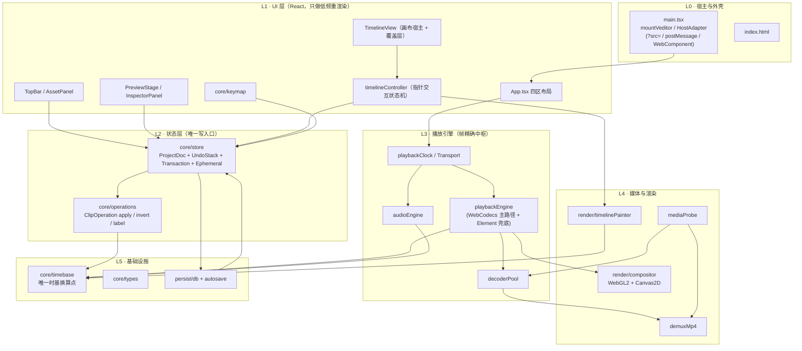
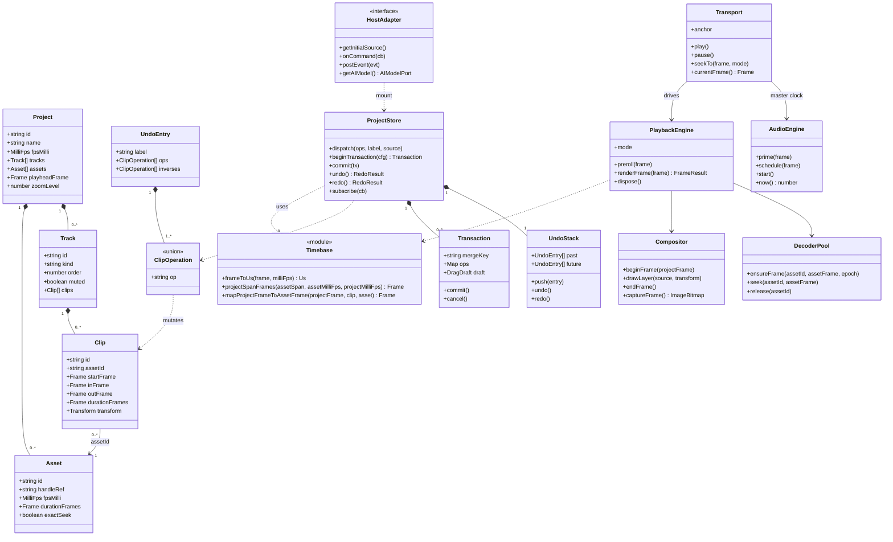
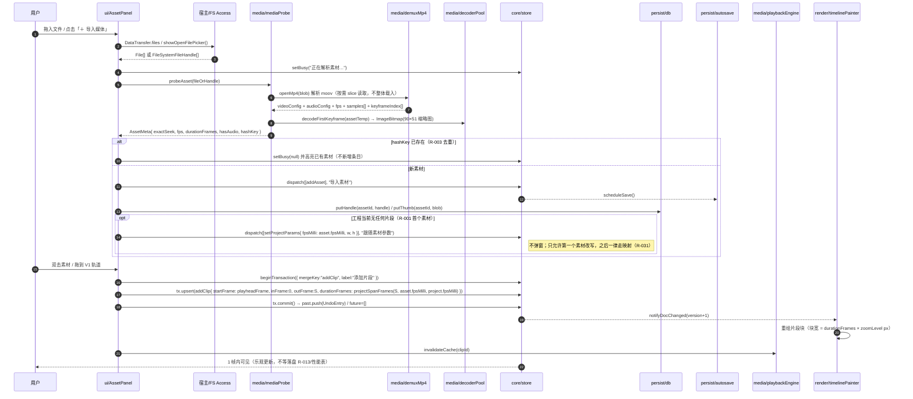
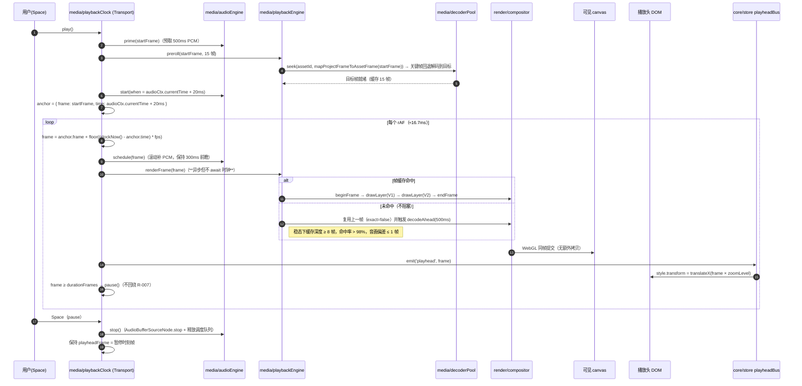
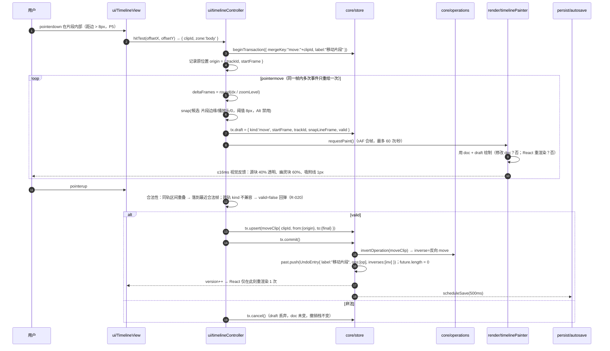
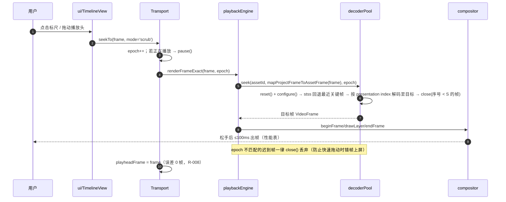

# veditor 系统架构设计与任务分解

- 工程代号：`veditor`
- 架构：高见远（Architect）｜版本 v1.0
- 输入：`docs/PRD.md`（R-001~R-032 P0）、`docs/tech-preflight.md`（WebCodecs 实测边界）
- 交付范围：**M1 能跑 + M2 能剪**；M3–M6 只在架构上留接口，不实现
- 全文单位约定：**数据层一律整数帧（frame），帧率一律整数毫帧率（milliFps），禁止出现秒与浮点毫秒**。仅有的例外是 `frameToUs()` 返回的整数微秒，它只服务于 WebCodecs 时间戳与音频调度，且只允许在 `src/core/timebase.ts` 内产生。
- 时基规格的权威来源是 `docs/frame-clock-spec.md`（PM 已补齐）；本文件 §5 是它的工程落地说明。

---

## 0. 八个核心架构问题的结论（速查表）

| # | 问题 | 结论（不可再讨论） | 详见 |
|---|---|---|---|
| 1 | 播放时钟 | **有可听音频时以 `AudioContext.currentTime` 为主时钟；无可听音频时以 `performance.now()` 为主时钟。rAF 只作"出帧触发器"，绝不参与计时。** 播放中永不 await 解码，只补帧/复用上帧；seek 才允许 await（exact 模式）。 | §8.1 |
| 2 | 解码策略 | **`DecoderPool` 按 assetId 池化：VideoDecoder 容量 2（V2/V1 各一）+ AudioDecoder 容量 1，LRU 超出即 `close()`。** seek 走 `epoch` 自增 + `reset()/configure()` + stss 关键帧回退 + 丢弃早于目标时间戳的帧。 | §8.2 |
| 3 | 合成器 | **WebGL2 为主（单 pass、每层一 quad、uniform 承载 transform/opacity、fragment 内混合），Canvas2D 为降级实现，二者同一 `Compositor` 接口。** 1080p 双轨 59fps 可达（GPU 合成 < 1.5ms/帧）。 | §8.3 |
| 4 | 时基 | **唯一换算点 = `src/core/timebase.ts`，纯函数、无状态、纯整数运算（帧率=毫帧率整数）；严格实现 `frame-clock-spec.md`（越界返回 `null`，不 clamp）；构建脚本 `scripts/check-timebase.mjs` 扫描全仓库，非法换算字面量出现即构建失败。预览与导出共用 `PlaybackEngine.renderFrame()`。** | §5 |
| 5 | 状态与撤销 | **自研 store + 逆向命令栈；`ClipOperation[]` = 1 个撤销步；拖动/裁剪/连续属性修改通过 Transaction `mergeKey` 做"替换式合并"，一次拖拽 = 1 步。** 无第三方状态库。 | §7 |
| 6 | 句柄持久化 | **FileSystemFileHandle 直接结构化克隆进 IndexedDB；恢复时只 `queryPermission`，`requestPermission` 必须在用户手势内。denied/离线 → `status:'offline'` + 重新链接；无 FS Access → memory 模式 + 常驻警告。** | §10 |
| 7 | 渲染/交互边界 | **时间线片段区 = Canvas2D 命令式绘制，React 完全不参与；拖动状态只写 `Transaction.draft`，rAF 合帧重绘；播放头/吸附线/幽灵块 = DOM transform。** | §9 |
| 8 | 可嵌入性 | **`HostAdapter` 抽象 + 唯一挂载入口 `mountVeditor(el, opts)`。M1 实现 `?src=` 与 Web Component；`postMessage` 四条命令已交付（R-050，2026-10-21，见 §11.2）；AI 通过 `HostAdapter.getAIModel()` 注入，M1/M2 返回 `null`（✦ 置灰）。** | §11 |

**技术栈一行话**：esbuild（自写 build/dev 脚本）+ React 19 + TS 严格模式 + 自研 store/撤销栈 + WebGL2 合成器（Canvas2D 降级）+ AudioContext 主机时钟（performance.now 降级）+ 自研 MP4 解封装 + 原生 IndexedDB 封装，运行时依赖仅 `react` + `react-dom`。

---

## 1. 架构总览

### 1.1 分层图



### 1.2 硬性依赖方向（违反即返工）

```
ui → core / render / media(只读接口) / persist(只读接口)
media → core(timebase,types)
render → core(timebase,types)
persist → core(types)
core → 无 DOM、无 WebCodecs、无 IndexedDB（core 必须可在 Node 里单测）
```

**`core/` 目录不得 import 任何 `ui/`、`render/`、`media/`、`persist/` 的符号**。这是"时基只有一份实现"和"撤销栈可单测"的前提。

唯一的、显式声明的例外：`core/store.ts` **允许** `import { useSyncExternalStore } from 'react'`（仅此一个符号），用于暴露 `useDoc/useSelection/useFrame` 三个订阅 hook；它不允许 import `react-dom`、不允许触碰 `window`/`document`/`canvas`。`core/timebase.ts`、`core/operations.ts` 保持零依赖，必须在纯 Node 环境下可单测。

### 1.3 一帧的数据流

```
rAF tick
  → Transport.frameAt(now)                    // 时钟（音频或 perf 锚点）
  → PlaybackEngine.renderFrame(frame)         // 取帧（缓存命中即用，未命中复用上帧）
      → DecoderPool.ensureFrame(assetId, assetFrame, epoch)
      → Compositor.beginFrame / drawLayer(V1/…) / endFrame
  → FBO 合成 → blit 到可见 canvas 上屏（同帧提交；导出时从同一 FBO readPixels）
  → EphemeralBus.emit('playhead', frame)      // DOM transform + aria-live 节流
```

---

## 2. 模块划分表

| 模块 | 职责 | 关键导出接口 | 依赖谁 |
|---|---|---|---|
| **build** `scripts/` `package.json` `tsconfig.json` | esbuild 打包/开发服务器（**固定 `127.0.0.1`**）、时基合规静态检查 | `npm run dev` / `npm run build` / `npm run check` | 无 |
| **shell** `src/main.tsx` `src/styles/app.css` | 唯一挂载入口、三种 HostAdapter 选择、secure context 自检、CSS 设计令牌与四区布局 | `mountVeditor(el, opts): VeditorHandle` | host 协议类型、ui |
| **core/types** | 全部领域类型 + 工厂函数（`createProject/createTrack/createClip/createAsset`）+ 错误码 + Host 协议类型 | 类型与工厂 | 无 |
| **core/timebase** | 毫帧率整数换算、帧↔微秒、项目帧↔素材帧映射、帧↔采样点（严格实现 `frame-clock-spec`） | `projectSpanFrames`, `mapProjectFrameToAssetFrame`, `assetFrameToProjectFrame`, `frameToUs`, `usToFrame`, `frameToSample`, `secondsToFrames` | types |
| **core/operations** | `ClipOperation` 的 apply / invert / 可读 label；工程参数变更的全量重算；纯函数 | `applyOperation`, `invertOperation`, `describeOperation`, `recomputeProject` | types, timebase |
| **core/store** | 唯一写入口：doc 读写、事务与合并、撤销栈、选择态、播放头总线、React hooks | `store.dispatch`, `beginTransaction`, `undo`, `redo`, `subscribe`, `useDoc`, `useSelection`, `playheadBus` | types, operations |
| **core/keymap** | 快捷键注册与匹配（输入框聚焦时除 Esc 外全部屏蔽）、平台修饰键归一 | `installKeymap(store, transport)`, `matchesKey` | store |
| **persist/db** | IndexedDB 封装（projects/handles/thumbs/settings 四个 store），配额错误映射 | `db.get/put/delete`, `db.open()` | types |
| **persist/autosave** | 500ms 防抖自动保存、句柄与缩略图写盘、启动恢复与权限探测 | `scheduleSave(project)`, `flushSave()`, `restoreSession()` | db, core |
| **media/demuxMp4** | 自研 ISO BMFF 解析：mp4/mov → 解码配置 + 样本索引（DTS/PTS 分离 + presentation order）+ 关键帧表；**不支持变体显式拒绝**（§8.5） | `openMp4(blob): Promise<Result<MediaProbeResult>>`, `readSample(index)` | types |
| **media/demuxWebm** | EBML/MKV 解析（T19）：Cluster/Cues/SimpleBlock/BlockGroup/三种 lacing → 与 mp4 **完全相同的 `SampleIndexEntry` 结构** | `openWebm(blob): Promise<Result<MediaProbeResult>>`, `readSample(index)` | types |
| **media/mediaProbe** | 探测素材元信息（时长/帧率/分辨率/音轨）、生成首帧缩略图、判定 `exactSeek` 与 `container`、按容器分发到 mp4/webm 解析器；**容器嗅探与解析分离**（§8.5） | `probeAsset(fileOrHandle): Promise<Result<AssetMeta>>`, `sniffContainer(source: BlobLike): Promise<ContainerKind>`，`ContainerKind = 'mp4' \| 'webm' \| 'unknown'`（不 throw，解析失败后仍可调用） | demuxMp4, demuxWebm, decoderPool |
| **media/decoderPool** | VideoDecoder 会话池、epoch 取消、关键帧回退、帧缓存与所有权 | `ensureFrame(assetId, assetFrame, epoch)`, `seek(assetId, assetFrame)`, `release(assetId)` | demuxMp4, types |
| **media/audioEngine** | AAC/Opus 解码 → 48kHz 重采样 → 环形 PCM 缓存 → AudioContext 精确调度 | `prime(frame)`, `schedule(frame)`, `start()`, `stop()`, `now()` | demuxMp4, timebase |
| **media/playbackClock** | Transport 状态机：播放/暂停/seek/逐帧；主时钟锚点切换 | `play/pause/toggle`, `seekTo(frame, 'exact' \| 'scrub')`, `currentFrame()` | timebase, audioEngine |
| **media/playbackEngine** | 帧精确渲染编排；WebCodecs 与 Element 两种实现；离线导出复用同一入口 | `renderFrame(frame): Promise<FrameResult>`, `preroll(frame)`, `mode` | decoderPool, compositor, demuxMp4 |
| **render/compositor** | 多轨合成（缩放/位置/不透明度/混合），WebGL2 主实现 + Canvas2D 降级 | `Compositor.beginFrame/drawLayer/endFrame/captureFrame` | types, timebase |
| **render/timelinePainter** | 时间线画布：标尺刻度、轨道、片段块、缩略图缓存、按帧换算像素 | `paint(ctx, state)` | timebase, types |
| **ui/App** | 四区布局、面板折叠、错误条、aria-live 播报节流 | `<App/>` | store, keymap, transport |
| **ui/TopBar** | 工程名双击重命名、`1920×1080 · 30fps` 入口（R-015 二次确认）、✦ 占位（置灰） | `<TopBar/>` | store |
| **ui/AssetPanel** | 导入（拖拽全窗 + 选择器）、素材网格 90×51、空态、拖到时间线/双击上轨 | `<AssetPanel/>` | store, mediaProbe, persist |
| **ui/PreviewStage** | 预览 canvas 宿主、播放控件条、时间码显示与跳转输入 | `<PreviewStage/>` | store, playbackEngine |
| **ui/InspectorPanel** | 4 项属性（缩放/位置/不透明度/混合）常驻灰显→可编辑 | `<InspectorPanel/>` | store |
| **ui/TimelineView** | 画布 + 覆盖层宿主、轨道头、工具条、缩放 | `<TimelineView/>` | timelineController, timelinePainter |
| **ui/timelineController** | 指针状态机：命中测试、拖动/裁剪/跨轨、8px 吸附、事务提交/回弹、seek/scrub | `createController(canvas, deps)` | store, timebase, painter |

**模块数：9 个功能模块（build / shell / core / persist / media / playback / render / ui / host 协议）+ 1 个规格测试层。**

---

## 3. 完整文件列表（31 个运行期文件）

> 目录规范：`src/{core,persist,media,render,ui,styles}`。无 `utils/`、无 `components/` 泛目录（避免堆放垃圾桶文件）。

| # | 相对路径 | 一句话职责 | 任务 |
|---|---|---|---|
| 1 | `package.json` | 依赖与 4 个脚本（dev/build/check/test） | T01 |
| 2 | `tsconfig.json` | TS 严格模式 + 路径别名 `@/*` + `noUncheckedIndexedAccess` | T01 |
| 3 | `index.html` | 单页宿主，含 `<div id="root">` 与 boot 失败提示容器 | T01 |
| 4 | `scripts/build.mjs` | esbuild 生产构建（bundle + minify + 单文件输出到 `dist/`） | T01 |
| 5 | `scripts/dev.mjs` | esbuild serve，**强制 `host: '127.0.0.1'`**，端口占用自动 +1 | T01 |
| 6 | `scripts/check-timebase.mjs` | 扫描除 `core/timebase.ts` 外的非法时基换算字面量，命中即 exit 1 | T01 |
| 7 | `src/main.tsx` | 唯一挂载入口：secure context 自检 → 选 HostAdapter → `mountVeditor()` → 注册 `<veditor-panel>`（T01 先建最小可用壳，T18 补全适配器） | T01 / T18 |
| 8 | `src/styles/app.css` | CSS 变量（`--v-*`）+ 四区网格布局 + 全部组件样式（极简自绘） | T01 |
| 9 | `src/core/types.ts` | 全部 interface/union + 工厂函数 + 错误码 + Host 协议类型 | T02 |
| 10 | `src/core/timebase.ts` | **唯一时基换算点**：毫帧率整数运算、帧↔µs、项目帧↔素材帧（越界返回 null）、帧↔采样 | T02 |
| 11 | `src/core/operations.ts` | `ClipOperation` 的 apply/invert/describe（纯函数，可单测） | T03 |
| 12 | `src/core/store.ts` | doc 读写、Transaction 合并、撤销栈、选择态、播放头总线、React hooks | T03 |
| 13 | `src/core/keymap.ts` | 快捷键表与匹配（含输入框聚焦屏蔽、macOS/Win 归一） | T11 |
| 14 | `src/persist/db.ts` | IndexedDB 打开/迁移/四个 object store 的 get/put/delete/配额错误映射 | T04 |
| 15 | `src/persist/autosave.ts` | 500ms 防抖保存、句柄与缩略图持久化、启动恢复与权限探测 | T04 |
| 16 | `src/media/demuxMp4.ts` | ISO BMFF 解析：stsd/avcC/stts/ctts/stss/stsc/stsz/stco/co64 → 样本索引 | T05 |
| 17 | `src/media/mediaProbe.ts` | 素材探测 + 首帧缩略图 + 不支持容器判定（→ Element 模式） | T05 |
| 18 | `src/media/decoderPool.ts` | VideoDecoder 会话池、epoch、关键帧回退、帧缓存与 `VideoFrame.close()` 配对 | T06 |
| 19 | `src/media/audioEngine.ts` | 音频解码 → 48k 重采样 → 环形 PCM → AudioContext 调度 | T10 |
| 20 | `src/media/playbackClock.ts` | Transport：播放/暂停/seek/逐帧、主时钟锚点、hidden 自动暂停 | T08 |
| 21 | `src/media/playbackEngine.ts` | 帧精确渲染编排；`WebCodecsEngine` + `ElementEngine` 两实现 | T09 |
| 22 | `src/render/compositor.ts` | WebGL2 合成器（含 shader 内联）+ Canvas2D 降级 + `captureFrame()` | T07 |
| 23 | `src/render/timelinePainter.ts` | 时间线画布绘制：三级刻度、轨道、片段块、缩略图位图缓存 | T15 |
| 24 | `src/ui/App.tsx` | 四区布局 + 折叠 + 错误条 + aria-live 播报 | T11 |
| 25 | `src/ui/TopBar.tsx` | 工程名、参数入口、✦ 占位 | T11 |
| 26 | `src/ui/AssetPanel.tsx` | 素材栏：导入、单列网格、空态、上轨 | T12 |
| 27 | `src/ui/PreviewStage.tsx` | 预览 canvas + 控件条 + 时间码输入 | T13 |
| 28 | `src/ui/InspectorPanel.tsx` | 右属性栏 4 项（禁用/可编辑切换） | T14 |
| 29 | `src/ui/TimelineView.tsx` | 时间线宿主：画布、覆盖层 DOM、轨道头、工具条 | T16 |
| 30 | `src/ui/timelineController.ts` | 指针状态机：命中/拖动/裁剪/跨轨/吸附/提交 | T16 |
| 31 | `src/media/demuxWebm.ts` | EBML/MKV 解析（T19）：Segment/Info/Tracks/Cluster/Cues、SimpleBlock/BlockGroup、三种 lacing → **复用同一 `SampleIndexEntry` 结构** | T19 |

**非运行期文件（不计入 31 个运行期文件）**

| 路径 | 用途 | 状态 |
|---|---|---|
| `tests/timebase.test.mjs` | `spec:T1`–`spec:T10` + `arch:S1`–`arch:S8` + `D1`–`D5` 的映射断言 | 待写（T02） |
| `tests/core.test.mjs` | operations / 撤销栈 / 事务合并 / `inverse` 深拷贝的断言 | 待写（T03） |
| `tests/fixtures/sample-720p.mp4` | E2E 基准素材（1280×720 / 30fps / 240 帧 / H.264+AAC） | ✅ 已有 |
| `tests/fixtures/compat/*.mp4`（6 个） | **T05 兼容性矩阵**：`faststart-bframes`（moov 前置 + B 帧）、`24fps`、`60fps`、`longgop`、`audioonly`、`hevc`；`compat/` **一个字节不动** | ✅ 已交付 |
| `tests/fixtures/compat/expected-meta.json` | T05 断言的唯一真相源（11 项 = 7 mp4 + 4 webm，含 `probe` 原始值与 `normalized` 归一化值；`webm-nocues` 的 `keyframeIndex`/`durationFrames` 为 `null` 属规格） | ✅ 已交付 |
| `tests/fixtures/compat/baseline.json` + `gen-baseline.cjs` | 结构性辅助断言（顶层 box 顺序与偏移、moov 位置）；**换算只允许发生在生成脚本里** | ✅ 已交付 |
| `tests/fixtures/hardline/*`（7 个文件） | **四条生死线专用**：`sample-720p`（1280×720/240）、`longgop`（640×360/240/**1 KF**）、`faststart-bframes`（640×360/120）、`long_ntsc`（640×360/23.976/**6000 帧/25 KF**/无 B 帧/无音频）、`webm-vp9-opus`（**1280×720**/240 包）、`24fps`（640×360/**240 帧**）、`ntsc23976`（640×360/240 帧） | ✅ 已就绪 |
| `tests/fixtures/hardline/expected-meta.json` | hardline 独立基线（`gen-baseline.cjs` 支持双目录），HL-* 用例与 T19 按目录取期望值 | ⏳ 生成中 |
| `tests/fixtures/ref/ref_000.png` `ref_137.png` `ref_239.png` | **`sample-720p` / webm 用**（1280×720）。`ref_137.png` = 192211 字节、md5 `acce30be355f61ed7c9aaf00b5650c79`，图上帧号 137 + 时码 `00:00:04.567` 双证 | ✅ 已确认 |
| `tests/fixtures/ref/ref_longgop_0.png` `ref_longgop_137.png` `ref_longgop_239.png` | **`longgop.mp4` 专用**（640×360，PM 补齐）——生死线 R-008 跑的是 640×360 的 longgop，**拿 1280×720 的 `ref_137.png` 比会开局就红且误报"seek 不准"** | ✅ 已补齐 |
| `tests/fixtures/ref/ref_webm_0.png` `ref_webm_137.png` | webm **硬断言**参考帧（1280×720），从重转后的 `hardline/webm-vp9-opus.webm` 自抽；`ref_webm_137.png` md5 `6f9d65387d971f8a76975459f355f246`（重转前旧值作废）。**不得用 mp4 参考帧做 webm 硬断言**（VP9 有损会吃掉全部容差预算） | ✅ 已生成 |
| `tests/fixtures/compat/webm-*.webm`（4 个）+ `tests/fixtures/hardline/webm-vp9-opus.webm` | T19 用例（**在 compat/ 与 hardline/ 两个目录，没有 `fixtures/webm/` 这个目录**）：`compat/vp9-opus`（4 KF/120 帧）、`compat/vp8-vorbis`（4/120）、`compat/longgop`（1/240）、`compat/nocues`（**无 Cues、无 Duration、12 Cluster、Segment size 未知**）、`hardline/vp9-opus`（1 KF/240 帧，与 `longgop.mp4` 对称） | ✅ 已交付 |
| `tests/e2e/media.spec.mjs` | 浏览器内 E2E（secure context）：导入 7 mp4 + 4 webm、面板缩略图逐像素、**断言素材卡片无任何格式/降级角标** | 待写（T09/T12） |
| `tests/e2e/timeline.spec.mjs` | 浏览器内 E2E：拖动/裁剪/吸附、`commitCount` 增量、撤销步数 | 待写（T16/T17） |

> **参考帧策略（已定案）**：① **按素材分组用帧** —— `ref_*.png`(1280×720) 给 sample-720p/webm，`ref_longgop_*.png`(640×360) 给 longgop；② **webm 硬断言只用 `ref_webm_137.png`**，`ref_137.png` 降级为"结构合理性校验"（两图平均差 < 20，证明无帧序错位、`seek(137)` 不越界），不进 R-008；③ `ref/` 下现共 **8 个 PNG**，若基线脚本会遍历该目录算哈希，**必须同步登记**，否则 CI 会报"未登记的 fixture"。

> ⚠️ **同名不同规格警告（`compat/` 与 `hardline/` 必须分目录，不得互相覆盖）**：`24fps.mp4` 在 compat 是 96 帧、在 hardline 是 240 帧；`longgop.mp4` 在 compat 是 720p、在 hardline 是 640×360；`webm-vp9-opus.webm` 在 compat 是 120 帧 / 720p、在 hardline 是 **240 帧 / 1280×720**（hardline 的 webm 特意保持 1280×720，以便与 `ref_137.png` 的尺寸匹配）。**两套 baseline 分开记录**，测试按目录取期望值。

**为什么是 31 个运行期文件（比原计划多 1 个）**：多出的 `src/media/demuxWebm.ts` 由 task:T19 带来——EBML 与 ISO BMFF 是两套完全不同的字节结构，塞进一个文件会得到 900+ 行、两个解析器互相污染的模块。

**其余文件为什么不再拆**：`core/store.ts` 已把"doc + 撤销 + 事务 + 播放头总线 + hooks"合并为单文件（约 400 行），`render/compositor.ts` 把 WebGL2 与 Canvas2D 两个实现合并（约 420 行）。再合并会让单文件超过 600 行，破坏可读性与可测性。
---

## 4. 核心数据结构

### 4.1 TypeScript 定义（持久化标记：`P`=写盘，`R`=运行时派生/不写盘）

> **状态标注（T05 补齐）**：本节类型**已在 `src/core/types.ts` 实现**（含 `MediaProbeResult`、`SampleIndexEntry`、`ErrorCode` 里的 `E_UNSUPPORTED_VARIANT` / `E_UNSUPPORTED_CONTAINER` 等）。**文档与代码不一致时以代码为准，并回来改文档**——本节曾出现"文档先行、代码未落"（§4.1 声明了 `MediaProbeResult`/`SampleIndexEntry` 但 `types.ts` 里没有，工程师按文档原文补齐），后续任何人改这里必须同步改 `types.ts`，否则 T02 的"导出符号逐项比对"守不住。

```ts
/* ---------- 基础 ---------- */
// 帧率一律以整数「毫帧率」存储（frame-clock-spec §4 规则 1）：30fps=30000、25fps=25000、
// 23.976=23976、29.97=29970、59.94=59940。doc 里禁止出现 29.97 这类浮点帧率。
export type MilliFps = number;

export type Frame = number;   // 整数帧。命名后缀约定：*Frame/*Frames
export type Us = number;      // 整数微秒，仅 timebase 内部与 WebCodecs 边界使用
export type Px = number;

/* ---------- 工程 ---------- */
export interface Project {
  id: string;                        // P
  name: string;                      // P  "未命名工程"
  fpsMilli: MilliFps;                // P  默认 30000（空工程兜底 30fps，R-001）
  width: number;                     // P  默认 1920
  height: number;                    // P  默认 1080
  sampleRate: 48000;                 // P  常量，禁止改动（R-032）
  frameMapPolicy: 'holdPrevious';    // P  常量
  durationRounding: 'halfUp';        // P  常量
  tracks: Track[];                   // P
  assets: Asset[];                   // P
  playheadFrame: Frame;              // P  刷新后恢复（R-013）
  zoomLevel: Px;                     // P  px/帧，1–20（R-029）
  schemaVersion: number;             // P  当前 1
  createdAt: number;                 // P  epoch ms（仅元数据，不参与剪辑运算）
  updatedAt: number;                 // P  epoch ms
}

/* 派生、不写盘、不参与撤销（由 store 计算并提供选择器）
   注：`durationFrames` 与 frame-clock-spec §1 的 Project.durationFrames 同义，但只作为派生值存在，
   写盘前由 store 重算，避免持久化值与被编辑的片段失配。 */
export interface ProjectDerived {
  durationFrames: Frame;             // R = max(track 末帧 + durationFrames)，无片段为 0
  clipCount: number;                 // R
  trackCounts: { video: number; audio: number };  // R
  offlineAssetIds: string[];         // R
}

/* ---------- 素材 ---------- */
export interface Asset {
  id: string;                        // P
  name: string;                      // P
  kind: 'video' | 'audio' | 'image'; // P
  handleRef: string | null;          // P  FileSystemFileHandle 在 IDB `handles` 中的主键；null=内存模式
  sourceMode: 'fs' | 'memory';       // P
  status: 'ok' | 'offline' | 'memory' | 'indexing'; // R  启动时探测后写回（不参与撤销）；indexing = 正在建索引（webm 无 Cues）
  fpsMilli: MilliFps;                // P  素材自身帧率（VFR 时取平均帧率；M2 不逐帧对齐）
  durationFrames: Frame;             // P  **素材时基**整数帧
  durationSec: number;               // P  仅校验用，不参与运算
  sampleRate: number;                // P  原始采样率
  channels: number;                  // P
  width: number;                     // P
  height: number;                    // P
  hasAudio: boolean;                 // P
  thumbnailRef: string | null;       // P  IDB `thumbs` 主键
  container: 'mp4' | 'webm' | 'unknown'; // P
  codecVideo: string | null;         // P  如 'avc1.640028'
  codecAudio: string | null;         // P  如 'mp4a.40.2'
  exactSeek: boolean;                // P  true=有 stss 可帧精确；false=仅 Element 模式
  hashKey: string;                   // P  `${name}|${size}|${lastModified}` 去重用（R-003）
}

/* ---------- 轨道 ---------- */
export interface Track {
  id: string;                        // P
  kind: 'video' | 'audio';           // P
  name: string;                      // P  "V1" / "A1"（可重命名 R-023）
  order: number;                     // P  0 起，越大越靠上/越后合成；V2=1 覆盖 V1=0
  locked: boolean;                   // P
  muted: boolean;                    // P  M 键（R-024）
  hidden: boolean;                   // P
  clips: Clip[];                     // P  按 startFrame 升序维护（invariant）
}

/* ---------- 片段 ---------- */
export type BlendMode = 'normal' | 'overlay' | 'screen' | 'multiply';

export interface Transform {
  scale: number;      // P  1 = 100%，范围 0–5（R-028 的 0–500%）
  x: number;          // P  相对画面中心的像素偏移（项目分辨率空间）
  y: number;          // P
  opacity: number;    // P  0–1
  blendMode: BlendMode; // P
}

export interface ClipAudio {
  gain: number;        // P  1 = 100%（M3 用到 0–2）
  fadeInFrames: Frame; // P  M2 恒 0
  fadeOutFrames: Frame;// P  M2 恒 0
}

export interface Clip {
  id: string;                 // P
  assetId: string;            // P
  trackId: string;            // P
  startFrame: Frame;          // P  **项目帧栅格**
  inFrame: Frame;             // P  **素材帧栅格**（含）
  outFrame: Frame;            // P  **素材帧栅格**（不含，exclusive）
  durationFrames: Frame;      // P  项目帧；invariant: === projectSpanFrames(outFrame-inFrame, asset.fpsMilli, project.fpsMilli)
  speedMilli: number;         // P  1000 = 1x（M3 用；M2 恒 1000）
  enabled: boolean;           // P
  transform: Transform;       // P
  audio: ClipAudio;           // P
  effects: Effect[];          // P  M2 恒空数组（M3 预留）
  transitionIn: Transition | null;  // P  M3 预留，M2 恒 null
  transitionOut: Transition | null; // P  同上
  source: 'ui' | 'ai';        // P  创建来源，供 AI 采纳追溯
}

export interface Effect { id: string; clipId: string; type: string; params: Record<string, number|string>; keyframes: Keyframe[]; enabled: boolean; order: number; source: 'ui' | 'ai' }
export interface Keyframe { frame: Frame; property: string; value: number; easing: 'linear' }
export interface Transition { type: 'crossDissolve'|'fadeIn'|'fadeOut'; durationFrames: Frame }

/* ---------- 变更单元（UI 与 AI 唯一载体） ---------- */
export type ClipOperation =
  | { op: 'addClip';     clip: Clip }
  | { op: 'removeClip';  clipId: string; removed: Clip }
  | { op: 'moveClip';    clipId: string; from: ClipPlacement; to: ClipPlacement }
  | { op: 'trimClip';    clipId: string; from: TrimState; to: TrimState }
  | { op: 'splitClip';   clipId: string; atProjectFrame: Frame;
                         left: TrimState; right: TrimState; newClipId: string }
  | { op: 'setClipProps';clipId: string; path: string; from: unknown; to: unknown }
  | { op: 'addTrack';    track: Track }
  | { op: 'removeTrack'; trackId: string; removed: Track }
  | { op: 'renameTrack'; trackId: string; from: string; to: string }
  | { op: 'rippleShift'; shifts: Array<{ clipId: string; from: Frame; to: Frame }> }
  | { op: 'setProjectParams'; from: ProjectParams; to: ProjectParams };

export interface ClipPlacement { trackId: string; startFrame: Frame }
export interface TrimState { inFrame: Frame; outFrame: Frame; startFrame: Frame; durationFrames: Frame }
export interface ProjectParams { fpsMilli: MilliFps; width: number; height: number }

/* ---------- 撤销 ---------- */
export interface UndoEntry {
  id: string;
  label: string;                 // 可读描述："移动片段" / "已剪掉前 3 秒"（R-046）
  ops: ClipOperation[];          // 正向
  inverses: ClipOperation[];     // 逆向（由 invertOperation 生成，倒序应用）
  source: 'ui' | 'ai';
  createdAt: number;
}

export interface UndoStack {
  past: UndoEntry[];    // 上限 50（可配 100）
  future: UndoEntry[];  // 新操作后清空（R-025）
}

/* ---------- 事务（拖动合并的关键） ---------- */
export interface Transaction {
  id: string;
  label: string;
  source: 'ui' | 'ai';
  mergeKey: string;                                  // 'move:<clipId>' / 'trim:<clipId>:left' / 'prop:<clipId>:transform.scale'
  ops: Map<string, ClipOperation>;                   // key = mergeKey+':'+targetId，同 key 替换而非追加
  draft: DragDraft | null;                           // 只影响绘制，不改 doc
}

export interface DragDraft {
  kind: 'move' | 'trim';
  clipId: string;
  trackId: string;          // 目标轨
  startFrame: Frame;
  inFrame: Frame;
  outFrame: Frame;
  durationFrames: Frame;
  snapLineFrame: Frame | null;
  valid: boolean;           // false → 回弹（显示禁止光标）
}

/* ---------- 瞬时视图状态（不写盘、不进撤销、不触发 React 全量渲染） ---------- */
export interface EphemeralState {
  selectedClipId: string | null;
  hoverClipId: string | null;
  drag: DragDraft | null;
  overlayMarks: OverlayMark[];        // M4：AI 建议切点，纯绘制层（不进撤销、不改片段）
  isPlaying: boolean;
  busyLabel: string | null;           // "正在解析素材…"
  errors: VEditorError[];             // 错误条
}

export interface OverlayMark {   // M4 使用，M2 仅定义类型
  id: string;
  frame: Frame;
  kind: 'suggestedCut';
  label: string;
  actionable: boolean;           // 点击"采纳"才生成 ClipOperation
}

/* ---------- demux 层返回（运行时，不持久化） ---------- */
export interface MediaProbeResult {
  container: 'mp4' | 'webm';
  hasVideo: boolean;                 // 纯音频 → false
  hasAudio: boolean;
  width: number | null; height: number | null;   // 纯音频无画面尺寸
  fpsMilli: MilliFps | null;         // 无视频 / 无 Duration 时为 null
  /** 素材时基帧数。**null 是合法返回值**（webm 无 Duration 且未扫描 Cluster 时），
   *  调用方必须显式处理：不得填 0、不得用 `!` 断言、不得参与 `>`/`<` 比较（`x > null` 恒 false）。
   *  null 时 `Asset.status = 'indexing'`，扫描完成后回填并转 `'ok'`。 */
  durationFrames: Frame | null;
  videoCodec: string | null;         // avc1.640028 / hvc1.1.6.L93.B0 / vp09.*
  audioCodec: string | null;         // mp4a.40.2 / opus / vorbis
  sampleRate: number | null; channels: number | null;
  /** presentation order 中的关键帧序号。mp4 来自 stss；**webm 必须以 Cues 为权威**（VP9 alt-ref
   *  会让 ffprobe 的 `-skip_frame nokey` 严重高报）。纯音频 = []；**无 Cues 且未扫描 = null**。 */
  keyframeIndex: number[] | null;
  samples: SampleIndexEntry[];       // 视频轨：与 presentation order 一一对应（可能为空，待扫描回填）；
                                     // 纯音频素材：是该音轨的**解码顺序**索引（AAC 帧粒度，此时 `index` 不是素材帧号）
  exactSeek: boolean;                // webm 在 T19 完成后与 mp4 同为 true
  needsIndexScan: boolean;           // true = 无 Cues/无 Duration，需异步全量扫描后回填
}

/** 样本索引：**接口就是对象数组**（对外类型固定为 `SampleIndexEntry[]`），**实现可自由选择内部存储**。
 *  允许内部用 5 个并行 TypedArray 优化，但**必须通过本接口暴露**（惰性转换，调用方无需感知）。
 *  **M2 阶段不需要 TypedArray 优化**：T05 实测 6000 样本的对象数组仅占 **0.55MB**，开销可忽略；
 *  若日后出现 216k 样本量级的素材（对象数组约 20MB，GC 压力才会显现）再改内部实现，**接口不变**。 */
export interface SampleIndexEntry {
  index: number;      // presentation order 序号（== 素材帧号 S）
  offset: number; size: number;
  dtsUs: number;      // 解码时间戳（stts 累加）；**可为负**（elst.media_time 重排延迟，实测首样本 −66667）；
                      // 唯一用途 = 排序（解码顺序）与诊断，**不可当时间戳喂解码器**（见 §8.2）
  ptsUs: number;      // 呈现时间戳（dtsUs + ctts offset）；喂 `EncodedVideoChunk.timestamp` 用这个
  isKey: boolean;     // 来自 stss（**解码顺序**语义，构建索引时已映射到 presentation 序号）
}

/* ---------- 帧渲染结果 ---------- */
export interface FrameResult {
  presentedFrame: Frame;   // 实际呈现的项目帧
  exact: boolean;          // false = 复用了上一帧（缓存未命中）
  layers: number;          // 参与合成的层数
}

/* ---------- 错误 ---------- */
export type ErrorCode =
  | 'E_SECURE_CONTEXT' | 'E_NO_WEBCodecs' | 'E_UNSUPPORTED_CONTAINER' | 'E_UNSUPPORTED_VARIANT'
  | 'E_DECODE_FAILED' | 'E_ASSET_OFFLINE' | 'E_PERMISSION_DENIED'
  | 'E_IDB_QUOTA' | 'E_AUDIO_UNAVAILABLE' | 'E_DECODER_EXHAUSTED'
  | 'E_INVALID_TIMECODE' | 'E_NO_MODEL';

export interface VEditorError { code: ErrorCode; message: string; detail?: string; at: number }
export type Result<T> = { ok: true; value: T } | { ok: false; error: VEditorError };
```

### 4.2 类图（模块级关系）



---

## 5. 时基实现规格（严格实现 `docs/frame-clock-spec.md`）

> `docs/frame-clock-spec.md` 已由产品侧补齐，是**权威规格**（公式、边界、取整方向、T1–T10 用例）。本节是它的工程落地说明：函数签名、使用范围约束、补充用例与静态检查。**两节如有措辞差异，以 `frame-clock-spec.md` 为准；本文件不重复推导，只补充工程约束。**
>
> **帧率在数据层一律是整数「毫帧率」`milliFps`**（spec §4 规则 1）：`30000`(30) / `25000`(25) / `23976`(23.976) / `29970`(29.97) / `59940`(59.94) / `60000`(60)。doc 里出现 `29.97` 这类浮点帧率即为 bug。

### 5.1 三个时基与唯一换算点

| 时基 | 单位 | 字段 | 规则 |
|---|---|---|---|
| 项目时基 | 项目帧 | `Project.fpsMilli` `Clip.startFrame` `Project.playheadFrame` | 时间线栅格，起点 0，整数 |
| 素材时基 | 素材帧 | `Asset.fpsMilli` `Asset.durationFrames` `Clip.inFrame/outFrame` | 解码栅格，整数 |
| 音频时基 | 采样点 | `Project.sampleRate`（48000）`Asset.sampleRate` | 混音前统一到 48kHz |

**唯一换算点 = `src/core/timebase.ts`**：纯函数、零依赖、Node 可直接单测。导出符号封闭为下面 **7 个函数 + 2 个常量**，不允许新增"顺手"的辅助函数：

> **本组函数必须能只凭参数算出正确结果，不得依赖任何派生/缓存字段。** 若某函数缺参数导致"只能反推"，正确做法是**改签名**，不是用现有字段近似。`Clip.durationFrames` 是 half-up 派生值，用它当除数会让映射错误被缓存错误掩盖——**且不抛异常、不越界、测试全绿**（D1 的 13 个帧里会错 12 个，却一条 spec 用例都不红）。

```ts
export const PROJECT_SAMPLE_RATE = 48000;
export const DEFAULT_FPS_MILLI = 30000;

// 时长：素材跨度 → 项目帧（spec §2 第 1 行，half-up，下限 1）
projectSpanFrames(assetSpanFrames: Frame, assetMilliFps: MilliFps, projectMilliFps: MilliFps): Frame

// 帧映射：项目帧 → 素材帧（spec §5；越界返回 null）
mapProjectFrameToAssetFrame(projectFrame: Frame, clip: Clip, asset: Asset, projectMilliFps: MilliFps): Frame | null

// 反向：素材帧 → 项目帧（spec §2 第 3 行；仅建片段/裁剪时使用，运行期禁用）
assetFrameToProjectFrame(assetFrame: Frame, clip: Clip, asset: Asset, projectMilliFps: MilliFps): Frame

// 时间戳与采样点（WebCodecs / 音频边界）
frameToUs(frame: Frame, milliFps: MilliFps): Us
usToFrame(us: Us, milliFps: MilliFps): Frame
frameToSample(frame: Frame, milliFps: MilliFps, rate?: number): number
secondsToFrames(sec: number, milliFps: MilliFps): Frame   // 仅供 Transport 从时钟秒数取帧
```

**为什么这两个函数必须显式接收 `projectMilliFps`（禁止"优化"回去）**：

> `projectMilliFps` 必须显式传入，**不得从 `Clip.durationFrames` 反推** `fs/fp` 比值。`durationFrames` 是 half-up 取整后的缓存值，用它当除数会把"缓存正确性"变成"映射正确性"的隐含前提——失准时不会抛错、不会越界，只会让画面节奏静默偏掉。

**实证反例（必须写成单测，见 `arch:S8`）**：`fs=60000 fp=30000 o−i=25` 时 `Lp=13`。若用 `divFloor((N−s0)×(o−i)/Lp)` 反推：`N=1→1`、`N=2→3`；规格要求 `N=1→2`、`N=2→4`。也就是说"隔帧取（0,2,4,6…）"被算成了"逐帧取（0,1,3,5…）"，**画面节奏慢一倍**且不报错。已实测 37 个非整除组合全部偏 −1。

另注：`Clip`/`Asset` 里已含 `fpsMilli`，但 `mapProjectFrameToAssetFrame` 仍需从外部拿项目帧率——`Clip` 属于项目帧栅格，不持有项目 fps。

### 5.2 整数防漂移的实现约束

```ts
// 与 spec §2/§4 完全一致的整数运算
divRoundHalfUp(a, b) = Math.floor((2 * a + b) / (2 * b));   // a, b > 0
divFloor(a, b)       = Math.floor(a / b);                    // 负数向下取整

// 时间戳（毫帧率下每帧 = 1e9 / milliFps 微秒）
frameToUs(f, milliFps)  = Math.floor((f * 1_000_000_000) / milliFps);
// 反向必须 half-up 补偿 frameToUs 的向下取整，否则回环会稳定少 1 帧
usToFrame(us, milliFps) = Math.floor((2 * us * milliFps + 1_000_000_000) / (2 * 1_000_000_000));

frameToSample(f, milliFps, r = 48000) = Math.floor((f * r * 1000) / milliFps);
secondsToFrames(sec, milliFps)        = Math.floor((sec * milliFps) / 1000);
```

- **中间积精度**：`f * 1e9` 在 `f ≤ 9_000_000`（83 小时）时 < 2^53，安全。超过则改用 `BigInt`（`timebase.ts` 内部决定，外部无感）。
- **只取整一次**：禁止 `floor` 与 `round` 串联（spec §4 规则 3）。
- **禁止以秒或浮点时间戳作中间量推进播放头**（spec §4 规则 4）：`Transport` 只允许用 `secondsToFrames(现在 - 锚点时刻)` 一次性得到偏移帧数，禁止 `dt` 累加。
- **已实测验证**（Node，与 `timebase.ts` 同算法）：`usToFrame(frameToUs(f)) === f` 对 `0 ≤ f < 216000`（@30000，2 小时）与 `0 ≤ f < 100000`（@29970）全部成立；`frameToUs(107999, 30000) === 3599966666`。
- **静态拦截**：除 `src/core/timebase.ts` 外，全仓库出现 `1e6` / `1e9` / `1000000` / `1000 / fps` / `fpsMilli / 1000`（后者仅允许出现在时间码基数计算 `tcBase` 与 UI 显示帧率处，由白名单文件放行）等帧↔时间换算即构建失败（`scripts/check-timebase.mjs`）。

### 5.3 边界语义（必须实现，不得"就近 clamp"）

| 边界 | 条件 | 返回 |
|---|---|---|
| startFrame 之前 | `projectFrame < clip.startFrame` | `null`（该轨此刻无画面） |
| 首帧 | `projectFrame === clip.startFrame` | `clip.inFrame` |
| 末帧 | `projectFrame === clip.startFrame + clip.durationFrames - 1` | `≤ clip.outFrame - 1`（hold-previous 的末帧） |
| outFrame 及之后 | `projectFrame ≥ clip.startFrame + clip.durationFrames` | `null`；**不得 clamp 继续 hold**（会延长片段，破坏 R-016 的帧数守恒） |
| 负帧号 | `projectFrame < 0` | 断言失败（`assert`，编程错误） |
| 素材边界 | `outFrame > asset.durationFrames` 或 `outFrame - inFrame < 1` | 拒绝建片段（`Result.ok=false`，`E_INVALID_TIMECODE`） |

**`null` 如何被消费（必须一致）**：`PlaybackEngine` 遍历可见轨道时，`mapProjectFrameToAssetFrame` 返回 `null` 的层直接跳过；**所有轨都返回 null 时合成器只清屏（黑帧），不准复用任意片段的帧**。

### 5.4 hold-previous 的四条不变量（单测必须断言）

1. 单调不减：`map(N+1) >= map(N)`（同在片段内时）。
2. 永不取未来帧：`map(N) < clip.outFrame`。
3. 首帧锚定：`map(clip.startFrame) === clip.inFrame`（裁剪后重新锚定，不会漂到 `inFrame-1`）。
4. 无反向推导：只允许 项目帧 → 素材帧；**素材帧不得推进播放头**（PRD §8 约定 5）。

### 5.5 音频时基

- 项目音频时基固定 48000Hz。音频调度一律用 `frameToSample()`，禁止 `frame / fps * 48000` 浮点路径。
- 导出/总时长一律用 spec §4 规则 6 的反推：`samples = divRoundHalfUp(durationFrames * 48000, fpsMilli)`。示例：`Lp=300, fp=30fps` → `480000`。
- 素材采样率 ≠ 48000 时在**混音前**重采样（线性插值，R-032）；`speedMilli` 与重采样互相独立（M3 的变速不改采样率）。

### 5.6 必测用例

**第一组：`docs/frame-clock-spec.md` §6 的 `spec:T1`–`spec:T10`（权威，逐条照抄断言，不得改期望值）**——本文件不再重复列出，直接以 spec 为准。（编号前缀约定见 §12 前言：`spec:` = spec 用例，`task:` = 本文任务，两者不同物。）

**第二组：架构补充用例（记为 `arch:S1`–`arch:S8`，`tests/timebase.test.mjs` 必须一并覆盖）**

> **重要局限**：`spec:T1`–`spec:T10` **全部是整除用例**（`(o−i)×fp` 恰好被 `fs` 整除），因此它们**证明不了**"用 `durationFrames` 反推 `fs/fp`"与"显式传 `fp`"这两种实现等价。`arch:S8` 就是为此设的非整除关卡，不得删除。

| # | 场景 | 条件（毫帧率） | 期望 |
|---|---|---|---|
| S1 | PRD R-031 验收口径 | `fs=24000 fp=30000 s0=0 i=0 o=240` | `durationFrames = 300`（24fps×10s → 300 帧） |
| S2 | 单帧素材下限 | `fs=24000 fp=30000 S=1` | `durationFrames = 1`（half-up 1.25 → 1） |
| S3 | 单帧素材下限（慢素材） | `fs=60000 fp=30000 S=1` | `durationFrames = 1`（half-up 0.5 → 1，不为 0） |
| S4 | 裁剪后重锚 | 在 S1 的 clip 左裁 1 帧 → `i=1, o=240` | `durationFrames = 299`；`map(0) = 1`；`map(298) = 239`（`= o-1`） |
| S5 | 无漂移回环（CI 快跑：**7200 帧 = 4 分钟 @30fps**） | `fpsMilli=30000`（另跑 `29970`），`f ∈ [0, 7200)` | `usToFrame(frameToUs(f)) === f` 全部成立。**注：7200 帧已足够暴露浮点累积误差与整数溢出；`216000` 帧（2 小时）只作本地 slow 用例，不进 CI** |
| S6 | 毫帧率精度 | `fs=23976 fp=29970 N=100 i=0 o=23976` | `map = 80`（与 spec T10 一致，验证不引入浮点误差） |
| S7 | null 区间 | S1 的 clip | `map(-1)` 断言失败；`map(300)` 与 `map(301)` 均为 `null`；`map(299) = 239` |
| **S8** | **非整除（防"用 durationFrames 反推"回归）** | `fs=60000 fp=30000`，`o−i=25`（→`Lp=13`），`s0=0 i=0` | `map(1)=2`、`map(2)=4`、`map(12)=24`（**隔帧取**）；若得 `1/3/…` 即为错误实现，必须让测试失败 |

**D 组速查（以 `hardline-test-spec.md` 为准，此处仅便于实现对照）**：

| # | fs / fp | span → Lp | 断言（正确值） | 反推比例会得 |
|---|---|---|---|---|
| D1（≡ `arch:S8`） | 60000 / 30000 | 25 → 13 | `map(1)=2`、`map(2)=4`、`map(12)=24` | 1 / 3 / 23 |
| D2 | 24000 / 30000 | 6 → 8 | `map(5)=4` | 3 |
| D3 | 30000 / 24000 | 6 → 5 | `map(4)=5` | 4 |
| D4 | 23976 / 29970 | 6 → 8 | `map(5)=4` | 3 |
| D5 | 25000 / 30000 | 2 → 2 | `map(1)=0`（hold-previous） | 1 |

这 5 组共 7 条断言是"反推比例"的唯一探针：`spec:T1/T2/T4` 恰好 floor 与 round 同值，抓不到；`arch:S1–S7` 也都在整除或半帧边界上。**T02 的完成判定必须包含它们**。另要求一个**独立验证脚本 `tests/verify-d-cases.mjs`**（不复用 `npm test` 的断言代码）作为第二判据——防止"测试套件自己长得像通过"（同 HL-R031-06 的思路：检查器与被检查对象不能是同一份代码）。

**还必须加一条"floor vs round"判别**（`spec:T1/T2/T4` 恰好 round 与 floor 同值，只跑它们抓不到这个错）：取 `spec:T2` 的条件（`fs=30 fp=24 s0=0 i=0 o=240`），`N=7` 时 `7×30000/24000 = 8.75`，**正确 floor → 8**，误用四舍五入得 9。它与 `arch:S8` 一起构成"取整方向"双保险（`hardline-test-spec` HL-R031-01 A2 即此条）。**完整的非整除判别集见 `hardline-test-spec` 的 `D1`–`D5`（其中 `D1 ≡ arch:S8`）**：D2/D4 的 `Lp` 恰好落在 7.5 → half-up 进 8（非整除 + 整除边界双陷阱）；D5 只有 2 帧（`map(1)=0`，专抓"短片段被提前显示"）。反推比例的实现在这 5 条上会稳定偏 1 帧。

### 5.7 预览与导出强制共用（R-031 的唯一保障）

- 预览：`Transport` → `PlaybackEngine.renderFrame(projectFrame)` → `Compositor`。
- 导出（M3）：`ExportPipeline` → **同一个** `PlaybackEngine.renderFrame(projectFrame)`（离线模式：不依赖 rAF，逐帧 await）→ `Compositor.captureFrame()`。
- 缩略图（R-003）：`mediaProbe` 通过 `mapProjectFrameToAssetFrame` 的**同一实现**取首帧，不允许自己写 `0` 或 `inFrame`。
- **导出层不允许出现任何帧换算代码**，也不允许新建第二套解码/合成路径。R-031 的"逐像素通道差 ≤ 2"只能靠这条单一通路满足。
- **导出层不存在 alpha 编码分支**：`VideoEncoder` 的 `alpha:'keep'`（vp8 / vp09.*）实测 `isConfigSupported === false`，因此透明需求一律走 R-062 的 **RGBA PNG 序列 + ZIP**（逐帧 `captureFrame()` 打 PNG，`frames.json` 记录 fps 与起止帧），**不设计、不预留 WebM/VP9 alpha muxing 路径**。M3 的导出形态只有 4 种：MP4/H.264、WebM/VP9（无 alpha）、GIF、纯音频。

### 5.8 单位命名法则（全仓库强制）

| 后缀 | 含义 | 示例 |
|---|---|---|
| `*Frame` / `*Frames` | 整数帧（必须注明项目帧还是素材帧） | `startFrame`（项目）、`inFrame`（素材） |
| `*Milli` | 毫单位整数（帧率、速度） | `fpsMilli=30000`、`speedMilli=1000` |
| `*Us` | 整数微秒 | `timestampUs` |
| `*Sec` | 秒，**只允许**出现在 `durationSec` 这类校验字段 | `durationSec` |
| `*Px` | CSS 像素 | `snapThresholdPx` |
| `*Ms` | 毫秒，只用于防抖/超时/UI | `autosaveDebounceMs` |

---

## 6. 关键时序图

### 6.1 ① 导入素材 → 上时间线（R-001/002/003/004/005/R-031）



### 6.2 ② 播放循环（解码 → 合成 → 上屏，R-006/007/011）



### 6.3 ③ 拖动片段并提交一次撤销（R-019/020/022/025）



### 6.4 ④ seek 帧精确（R-008，补充）



---

## 7. 状态管理与撤销栈（Q5 详述）

### 7.1 为什么自研而不引入 Zustand/Redux/Immer/zundo

| 需求 | 第三方方案的缺口 |
|---|---|
| "一次拖拽 = 1 步撤销" | zundo/immer 的 patch 栈按"每次 setState"记一步 → 拖 60 帧产生 60 步，需要额外写合并逻辑，代码量与自研相当 |
| ≤ 50MB / 50 步 | 快照式方案（structuredClone 整 doc）在 30 分钟工程上轻松超 10MB/步，必须用逆向操作 |
| 16ms 内反馈且不触发 React 重渲染 | 状态库的 `setState` 天然触发订阅通知；拖动必须绕开 doc |
| 零依赖 | 运行时依赖只允许 react/react-dom |

结论：**自研 ~400 行**，包含逆向命令栈 + 事务合并 + 双通道订阅（doc 低频 / playhead 高频）。

### 7.2 数据结构

```ts
interface StoreState {
  doc: Project;                 // 持久化文档（不可变替换：每次修改生成新的 tracks 数组引用）
  undo: { past: UndoEntry[]; future: UndoEntry[] };
  ephemeral: EphemeralState;    // 不写盘
  version: number;              // doc 变更计数（React 订阅用）
}
```

### 7.3 三个入口，一条写路径

```ts
// 1) 原子提交（离散操作：切分/删除/波纹删除/加轨/改属性确认）
store.dispatch(ops: ClipOperation[], label: string, source: 'ui'|'ai'): void

// 2) 事务（连续操作：拖动/裁剪/滑块滑动）
const tx = store.beginTransaction({ mergeKey, label, source });
tx.upsert(op);        // 同 mergeKey → 替换（不是追加）
tx.setDraft(draft);   // 只影响绘制
tx.commit();          // 生成 1 个 UndoEntry
tx.cancel();          // 丢弃

// 3) 撤销/重做
store.undo(): { label: string; opCount: number } | null
store.redo(): { label: string; opCount: number } | null
```

### 7.4 合并策略（关键）

- `mergeKey` 决定合并边界：`move:<clipId>`、`trim:<clipId>:left`、`trim:<clipId>:right`、`prop:<clipId>:<path>`。
- `tx.ops` 是 `Map<mergeKey, ClipOperation>`，**同一 key 后写覆盖前写**，天然保证"一次拖拽 = 1 条 op"。
- 提交时 `ops.values()` → `ops[]`，同时 `inverse = ops.map(invert).reverse()`。
- 跨不同属性的连续改（如同时改 scale 和 x 的 AI 指令）→ mergeKey 不同 → 但同属一个 `dispatch(batch)` → 仍是 **1 个 UndoEntry**（满足 R-046"一次 AI 操作 = 一个撤销步"）。
- 撤销栈上限 50：**先判上限再 push**（写成 `if (past.length === 50) past.shift(); past.push(entry)`，保证 60 次操作后长度恰为 50，不是 51）。撤销栈内存只需存 payload（典型 move op ≈ 300B，50 步 < 20KB，远低于 50MB 预算）。
- **`inverse` 的 payload 必须深拷贝**（`structuredClone` 或显式字段复制），**不得与正向 op 共享同一个 clip 对象**。否则"撤销 → 改属性 → 再撤销"会读到被污染的逆操作快照（`hardline-test-spec` HL-R025-06 专门抓这个：A2 期望 `opacity === 1.0`，共享引用会得 0.3）。
- 撤销必须是增量应用逆向 op，**不得克隆整个 doc**；验收线：100 片段工程单次撤销 ≤ 50ms（HL-R025-03 A3）。
- **切分两侧帧数之和会偏 ±1，这是数学必然，不是缺陷**：`A.dur = roundHalfUp(A.span × fp / fs)`、`B.dur = roundHalfUp(B.span × fp / fs)` 是**两次独立的 half-up**，而 `A.span + B.span` 才等于原 span。实测 7 组帧率组合 × 1773 个切点，**206 个（11.6%）会偏 ±1**，改用 `ceil` 选切点同样有 206 个。因此 R-016 的口径是"C1/C2/C3 零容差 + C4 允许 ±1（同帧率必须 0）"，实现按 `remaining = Lp − durA` 计算 `B.dur` 可让偏差有界且可解释。**这条成因说明必须留在代码注释里**，否则后人会"修"它。同时 `operations.ts` 的 `splitClip` 函数**顶部注释必须逐字写上**：「**不得调整 `inFrame`/`outFrame`**：`B.dur` 用 `remaining = Lp − durA` 计算，偏差 ±1 由 R-016 C4 容忍；改 `outFrame` 会丢素材末帧。」——将来没人会翻 §7.4，但都会看这个函数。
- **不进撤销栈的东西**（明确写死）：`playheadFrame`、`zoomLevel`、`selectedClipId`、`overlayMarks`、`asset.status`、**首个素材自动改写工程参数（R-001）**、Autosave 时间戳。R-015 的**手动**改工程参数必须进栈（`setProjectParams`）。

### 7.5 双通道订阅（避免 React 全量重渲染）

| 通道 | 频率 | 载体 | 订阅方 |
|---|---|---|---|
| doc 通道 | 每次 commit / dispatch（≤ 每秒几次） | `store.subscribe(fn)` + `useDoc(selector, eq)` | 面板、属性栏、顶栏 |
| playhead 通道 | 60Hz | `playheadBus.subscribe(fn)`（**不经过 React**） | 播放头 DOM、时间码文字（节流 100ms）、aria-live（节流 500ms） |

`useDoc` 实现要点：`useSyncExternalStore(subscribe, () => selector(doc))` + 浅比较；`selector` 必须返回原始值或稳定引用，禁止在 selector 里新建对象/数组（否则每次都重渲染）。

### 7.6 工程参数变更（R-015）的重算 —— 保间隙 + 只贴紧 + 不级联

> 决策已冻结（PRD R-015 / `frame-clock-spec.md` §7）。**明确否决级联右推（ripple）**：级联会让"改一次帧率再改回来"无法复原（语义损失，即使撤销栈能退、工程状态也已不同），且用户改 fps 的心理模型是"同一部片、只是帧率不同"，片段整体位移会被理解为"我剪好的东西被动过了"。**间隙是意图，不是垃圾**（留黑、留呼吸、给转场留位置），不得静默消除。

`Project.fpsMilli / width / height` **不是不可变常量**：R-001 允许首个素材改写，R-015 允许用户二次确认后改写。因此必须有一条**唯一的重算路径**。

**自检口诀（防再次写反）**：帧数变多还是变少，看 `newFpsMilli / oldFpsMilli` 的方向 —— 30→24 帧率降低，同样 10 秒应该用**更少**的帧数，所以 300 帧必须变 240 帧；任何算出 375 的都是把比值倒置了。**两个方向都必须满足"秒数不变"**（`300/30fps = 10.000s → 240/24fps = 10.000s`；`240/24fps → 300/30fps`），这才是"保间隙"成立的前提——间隙是按秒留的，秒数变了间隙就变了。

**触发点只有一个**：`store.dispatch([{ op:'setProjectParams', from, to }])`，应用顺序固定为 5 步：

1. 写入新的 `fpsMilli / width / height`；
2. 逐轨、按 `startFrame` 升序重算 `durationFrames = projectSpanFrames(outFrame - inFrame, asset.fpsMilli, newFpsMilli)`（**素材跨度 `outFrame-inFrame` 不动 → 不丢帧；片段在时间线上的绝对时长不变**）；
3. `newStartFrame = divRoundHalfUp(oldStartFrame * newFpsMilli, oldFpsMilli)`（**按绝对时间等比映射 → 原有间隙自动保留**，不会凭空产生空洞）；
   **方向校验（必须写进单测，写反了整条时间线会被拉伸）**：30fps→24fps 时 `oldStart=300`（=10.000s）必须得 `240`（=10.000s @24fps）；24fps→30fps 时 `oldStart=240` 必须得 `300`。即分子永远是**新帧率**。
4. **只在取整冲突时贴紧**：若 `newStartFrame < prevClip.newEnd`（同轨前一个片段的新末帧），则 `newStartFrame = prevClip.newEnd`，**位移 ≤ 1 帧**；
5. `playheadFrame = divRoundHalfUp(oldPlayhead * newFpsMilli, oldFpsMilli)`（同一方向）并 clamp 到 `[0, durationFrames-1]`；整批 = **1 个 UndoEntry**。

**明确禁止（写死，不允许"优化"）**：删除间隙、整轨级联右推、重采样/裁剪素材、修改 `inFrame/outFrame`。取整误差只允许用"贴紧前一个片段"这一种方式消解。

**弹窗必须事先算出影响面（R-015 的"事先告知"）**：确认前用 `previewRecompute(doc, newParams)`（纯函数、不落地）给出两个数字 —— **受影响片段数**（`newStartFrame` 或 `durationFrames` 发生变化的 clip 数）与 **最大位移帧数**（`max |newStart - oldStart|`）。禁止只写"已有片段将重新换算"这种无信息文案。

**不变式（task:T17 第⑦条验收断言）**：

- **绝对时间位置偏差 ≤ 1 帧**（整数断言，不用浮点）：`abs(newStart × oldFpsMilli − oldStart × newFpsMilli) ≤ newFpsMilli`（即把 newStart 换算回旧帧栅格后与 oldStart 相差 ≤ 1 帧）；
- **原有间隙仍在**：相邻两片段的间隙帧数（`nextStart − prevEnd`）变化 ≤ 1 帧，且数量不变（不能有间隙被吃掉）；
- 素材跨度 `outFrame-inFrame` 不变 → 无丢帧；**同轨重叠 ≤ 1 帧**（只允许由取整/贴紧产生，与 R-016 C4 的 ≤1 帧容差同源）；片段顺序不变；
- 幂等：`recomputeProject(recomputeProject(p, A).doc, A).doc` 与原结果深度相等；
- 撤销后 `fpsMilli` 与所有 `startFrame/durationFrames` 全部回到重算前；
- `Asset.fpsMilli` **永不**因工程参数变更而改动（否则 R-031 的映射基准就漂了）。

**实现归属**：`core/operations.ts` 导出 `previewRecompute(doc, params)` 与 `recomputeProject(doc, params): { doc, ops: ClipOperation[] }`（均为纯函数）；`store.ts` 只负责把 ops 包成 1 个事务提交；`timebase.ts` 只提供 `projectSpanFrames`。**禁止在 UI 层做重算**（否则会出现第二份换算）。

---

## 8. 播放、解码、合成、时钟（Q1/Q2/Q3 详述）

### 8.1 播放时钟（Q1）

**选型：`Transport` 持有一个"锚点"，主时钟二选一。**

```ts
interface ClockAnchor {
  frame: Frame;    // 锚点帧
  time: number;    // 锚点时刻（秒，来自当前主时钟源）
  source: 'audio' | 'perf';
}
// frame = anchor.frame + secondsToFrames(now() - anchor.time, fpsMilli)
```

| 条件 | 主时钟 | 理由 |
|---|---|---|
| 时间线在播放头处有可听音频（存在未静音音频轨且有片段） | `AudioContext.currentTime` | 音频一旦开始就无法变速纠正；让视频跟随音频，R-006（≤1 帧/10s）天然满足 |
| 无音频 / 全部静音 / AudioContext 被 suspend / 解码失败 | `performance.now() / 1000` | 无音频时以单调时钟为准，避免 rAF 抖动累积 |
| `document.hidden === true` | 强制 pause | 后台 rAF 节流会导致音画雪崩 |
| Tab 切换回来 | 重新锚定（不补齐丢掉的帧） | 防止"补帧风暴" |

**切换主时钟不跳帧的做法**：切换瞬间同时写入两个值——`anchor = { frame: currentFrame(), time: newSource.now() }`，之后只用新源。切换点由 `AudioEngine` 上报（`onUnderrun` / `onAudioLost`）。

**seek 的三种模式（`Transport.seekTo(frame, mode)`）**：

- `scrub`（拖动中）：同一 rAF 内只保留最后一个目标（`epoch` 覆盖），中间请求直接丢弃；允许出示最近缓存帧/最近关键帧，**但绝不允许黑屏**。
- `preview`（松手瞬间）：**立即**用现有缓存里最接近目标的一帧上屏（`exact=false`），保证"松手 ≤100ms 有画面"；同时把 `exact` 任务排进队列。
- `exact`（收敛）：暂停时钟 → `await renderFrameExact(frame)` → 上屏 → 恢复；**必须在 ≤800ms 内完成**，否则视为失败（HL-R008-06：不允许停在近似帧）。

**两段式的意义**：它把"永不白屏"与"最终必须精确"拆成两个可分别验收的约束，同时堵住一种常见偷懒实现——"拖动时干脆不画"（松手会超过 100ms 无画面）与"停在近似帧不追"（`exact` 永远为 false）。

`seekTo(target, 'exact')` 的语义固定为：**返回的那一帧 `presentedFrame === target` 且 `exact === true`**，不返回中间态。

**rAF 的职责**：仅 `requestAnimationFrame` → 读时钟 → 出帧。它不用于计时（rAF 在 120Hz 屏是 8.3ms、在负载下会掉到 30Hz，用它计时必然漂移）。

### 8.2 解码策略（Q2）

**池化：`DecoderPool` 以 assetId 为键，VideoDecoder 上限 2、AudioDecoder 上限 1，LRU 淘汰时 `close()`。** 为什么是 2：V2 覆盖 V1，同一时刻最多需要两个不同 `assetId` 的画面；同轨相邻片段切换时通过 `seek()` 复用同一 session（切换成本 = 一次关键帧回退，典型 < 30ms，但**只发生在片段边界**，可用 preroll 提前准备）。

```ts
interface DecoderSession {
  assetId: string;
  decoder: VideoDecoder;
  epoch: number;            // seek 代次；迟到帧比对后丢弃
  nextSampleIndex: number;  // 下一个待喂样本
  buffered: VideoFrame[];   // 已解码待消费（按 timestamp 升序）
  lastUsedAt: number;
}
```

**关键帧回退（帧精确 seek 的唯一正确做法）—— 按 `presentation index` 定位，不靠时间戳比较**：

> 这是 VFR 素材唯一不会错的做法：`stts` 会把 VFR 素材的 PTS 拉成不正常间隔，用"时间戳比较"去判断"解到第几帧"必然多一帧或少一帧；而**解码器的输出顺序 == 呈现顺序（presentation order）== `samples[]` 的数组顺序**（`samples` 已按 `ptsUs` 升序重排，`index` 即呈现序号），所以用序号计数是精确的。**注意"喂入顺序"与"输出顺序"不是同一件事**：喂入必须按**解码顺序**（`dtsUs` 升序），输出才是呈现顺序——详见下方 `dtsUs` 规则。

1. `S = mapProjectFrameToAssetFrame(projectFrame, clip, asset)`（null 则该层跳过）。`S` 直接就是**样本序号**（素材帧栅格与该素材的呈现序号 1:1）。
2. 在 `demuxMp4` 的 `keyframeIndex`（来自 `stss`，升序样本序号）里二分查找 `≤ S` 的最近关键帧序号 `kf`。
3. `decoder.reset()` → `configure(config)` → 从样本 `kf` 开始 `decode(EncodedVideoChunk)`（**取样本的顺序是 `dtsUs` 升序，不是数组下标顺序**，见下方 `dtsUs` 规则）；每个输出帧用它的 `timestamp`（= 我们填的 `ptsUs`）反查 `ptsUs → presentation index` 表，得到 `pIdx`。
4. 输出回调里：`pIdx < S` → 立即 `frame.close()`（丢弃）；`pIdx === S` → 送入 `FrameCache` 并停止喂样本；`pIdx > S` → `close()`（防御性，正常不会走到）。
5. 无 `stss`（全关键帧或损坏）→ 直接从样本 `S` 开始喂；若素材 `exactSeek=false` 则整体改用 `ElementEngine`。
6. **PTS 的两个合法用途**（不得用于"解到第几帧"的判断）：① 导出时给 `EncodedVideoChunk`/封装器写时间戳；② 诊断日志与 CFR 素材的自检断言（`|pts(S) - frameToUs(S, asset.fpsMilli)| ≤ 1 帧` 时视为 CFR）。

> **`dtsUs` 可能为负；喂入顺序按 `dtsUs` 升序，`timestamp` 用 `ptsUs`**（task:T06 必读）。B 帧重排延迟（`edts/elst.media_time` 非零）会让首个样本的 DTS 早于 0：T05 实测 `faststart-bframes.mp4` 首样本 `dtsUs = −66667, ptsUs = 0`。**负 `dtsUs` 是合法值，不是 bug、不是文件损坏**。四条硬约束：
> ① `EncodedVideoChunk.timestamp` **必须用 `ptsUs`**——WebCodecs 的 timestamp 语义是**呈现时间**，不是解码时间；用 `dtsUs` 会让首帧时间戳差一个重排延迟（33ms 级），task:T06 ①（`timestamp === frameToUs(137, 30000)`）直接红，且现象像"seek 不准"。
> ② **喂入（提交）顺序必须按 `dtsUs` 升序**（= mp4 中样本的存储顺序/解码顺序）。**不能按 `samples[]` 数组下标升序喂**：`samples` 在 T05 里已按 `ptsUs` 重排为 presentation order（`index` = 素材帧号 `S`），存在 B 帧时数组顺序 ≠ 解码顺序，按数组顺序喂会把 B 帧提到它依赖的 P 帧之前 → 解码器报错或出绿块。`SampleIndexEntry` 不额外存解码序号，取解码顺序用 `samples.slice().sort((a,b) => a.dtsUs - b.dtsUs)`（**同一素材只算一次并缓存**，不要在每帧 seek 里重排）。
> ③ **禁止 clamp**：`Math.max(0, dtsUs)` 会让整条时间轴整体前移一个重排延迟，首帧时间戳错位，排查时看起来像"seek 不准"，成本极高。**`dtsUs` 的唯一用途是排序与诊断，不是时间。**
> ④ 输出回调里判定"这是第几帧"**用输出帧的 `timestamp`（就是我们喂进去的 `ptsUs`）反查 `ptsUs → presentation index` 映射表**（同一素材建一次并缓存，重复 PTS 取先出现者）；**不要**用"已喂样本数 + 1"推算（喂入序 ≠ 呈现序），也尽量不用裸自增计数（VP9 alt-ref 帧会让输出帧数多于展示帧数）。

**VP9 的 alt-ref（invisible）帧**：解码输出里可能包含**不参与显示**的帧（它们只作为后续帧的参考，`VideoFrame` 仍会产生）。因此 `DecoderPool` **不得假设"每输出一帧就要上屏一帧"**，`presentationIndex` 只能对"展示帧"递增；判断展示帧的依据是 demux 层的样本表（Cues 解析出的 presentation order），不是解码回调次数。这是 task:T19 与 task:T06 的接口约定。**T19 侧的输出契约**：一个视频 `SimpleBlock` = 一个展示帧；若遇到 superframe 内含 invisible 帧的流，**T19 必须在解析阶段显式拒绝**（`E_UNSUPPORTED_VARIANT`，detail 写明 "webm 含 invisible/alt-ref 帧"），**不得把 invisible 帧当作样本输出**——否则 `durationFrames` 偏大、`presentationIndex` 整体错位，现象是"seek 差几帧"，几乎无法归因（详见 task:T19 ⑨）。**当前 5 个 webm fixture 均不含 invisible 帧**，所以这条只能靠代码防御。

**demux 的兼容性边界见 §8.5**（支持哪些变体、哪些必须显式拒绝）；样本索引缺失或非法（stbl 表损坏）时，`decoderPool` 必须整条素材降级，不得"猜帧"。

**VFR 的范围界定（与 `frame-clock-spec.md` §3 一致）**：`Asset.fpsMilli` 取平均帧率（`durationFrames / durationSec` 四舍五入到毫帧率），项目帧→素材帧一律按平均帧率换算，**M1/M2 不做逐帧时间戳对齐**。因此 VFR 素材的呈现节奏在时间线上是被"平均化"的（可能出现重复帧/跳帧），这是已接受的范围，不是 bug；导出时以样本序号对齐，保证预览与导出仍是同一帧。

**前向播放不做 seek**：继续喂 sample，保持 `decodeAheadUs = 500_000`（约 15 帧 @30fps）。缓存未命中时复用上一帧，**绝不阻塞 rAF**。

**VideoFrame 所有权规则（必须写成代码注释）**：
- `DecoderPool` 产出的帧归 `FrameCache` 所有；
- 交给 `Compositor.drawLayer()` 期间不得 `close()`；
- `endFrame()` 之后由 `FrameCache` 决定回收（超过 `maxCacheBytes = 64MB` 或超过 24 帧 → `close()` 最旧）；
- 任何"丢弃"路径必须 `close()`，否则硬解会话会卡死（Chromium 上未 close 的帧会耗尽解码器配额）。

### 8.3 合成器（Q3）

**选型：WebGL2 主实现，Canvas2D 降级。** 同一 `Compositor` 接口：

```ts
interface Compositor {
  readonly kind: 'webgl2' | 'canvas2d';
  resize(w: number, h: number): void;
  beginFrame(projectFrame: Frame, clear: boolean): void;
  drawLayer(source: VideoFrame | ImageBitmap | HTMLVideoElement, t: Transform): void;
  endFrame(): void;                       // 提交到目标 canvas
  captureFrame(): Promise<ImageBitmap>;   // 导出用（M3），与预览同一管线
  dispose(): void;
}
```

- **层序**：`track.order` 升序绘制（order 0 最底），仅 `kind==='video' && !hidden` 的轨道参与。
- **同轨重叠（≤1 帧，来自 R-016 C4 / §7.6 取整）—— 已定案**：`overlapWinner` = **`startFrame` 更小者优先（后绘制、压在上面）；`startFrame` 相等时取 `index` 更大者**。**纯数据决定，禁止引入 `createdSeq`/建立顺序字段**——建立顺序需要额外持久化、并在导出时重放，一旦重放错位就会让"预览 ≠ 导出"，而重叠只有 1 帧（33ms，肉眼不可见），为它冒这个风险不值。预览与导出调用**同一个**排序函数。
- **无层时清屏为纯黑**：所有可见轨在该帧 `mapProjectFrameToAssetFrame` 返回 `null` 时，必须 `gl.clearColor(0,0,0,1)` + `gl.clear(COLOR|DEPTH)` 清**整张 FBO**（再 blit 上屏），且 `captureFrame()` 前不得插入额外 clear（否则截图与上屏不同源）；**判空必须显式 `=== null`，禁止用 `??` 或 truthy 判断**（`0` 是合法帧号、`null` 才表示无画面，`0 ?? x` / `0 || x` 都会走错分支）；**验收**：空白区截图必须做**全画面 8×8 分块扫描**（`isBlack`），每块内所有像素 RGB ≤ 2，且与片段首/末帧平均差 **> 20**（HL-R008-05 / HL-R031-05；这个"必须明显不同"的线**不能用通过线 15**，也不能停在此前的 > 10——跨链路噪声上界实测 10.34，> 10 与"正确帧通过线 ≤15"重叠、判不出到底是"空白"还是"跨链路偏差"；错帧实测 ≈26，故取空档中点 20：`15 < 20 < 26`，见附录 B.1）——**只查边缘会漏判"中间有个黑色矩形"**；同时不允许把首末帧"遗留"到空白区。
- **transform 映射**：顶点着色器用 uniform 传 `u_scale/u_offset/u_canvasSize`，`uv` 翻转由 `UNPACK_FLIP_Y_WEBGL` 处理；`opacity` 预乘到纹理采样值。
- **混合模式**：`normal` 走 `gl.blendFunc(SRC_ALPHA, ONE_MINUS_SRC_ALPHA)`；`multiply/screen/overlay` 在片段着色器内对已累积的目标做逐像素公式（单 pass 多纹理不可行时，采用 2 pass：先渲染底层到离屏 FBO，再以上层为源混合）→ **M2 采用 FBO 2 pass**，实现简单且确定。
- **`captureFrame()` 必须与预览共用同一个 WebGL2 上下文与同一张 framebuffer**（不得新建第二个 canvas、不得另写一条"离屏渲染"通路）。原因：`hardline-test-spec` HL-R031-04 要求"预览路径"与"单帧直出路径"的 RGBA **同源**——主判据是 `frameIndex` 完全相等、次判据是 `maxCh ≤ 2`（仅吸收 readback 舍入）。**这条 `maxCh ≤ 2` 是"同一条链路内的两条读出路径"，与跨链路的 15/20dB 无关，严禁被放宽到 15**（若有人把它改成 15，等于允许"两条各画一遍"的近似实现蒙过去）。实现路径（消除 `preserveDrawingBuffer` 依赖）：所有 layer 先合成到**同一个 FBO 纹理**，`endFrame()` 之后把它 blit 到可见 canvas 上屏；`captureFrame()` 从**同一个 FBO** `readPixels`。这样"上屏像素"与"截图像素"是同一份数据，`maxCh` 天然为 0，且不需要 `preserveDrawingBuffer: true`（那个选项会拖慢上屏）。
- **Canvas2D 降级**：`globalAlpha` + `globalCompositeOperation`（`source-over/multiply/screen/overlay` 原生支持），`drawImage(videoFrame, x, y, w, h)` 在 Chromium 上是 GPU 加速路径。

**性能预估（必须留可验证的预算）**

| 场景 | 分解 | 预估 | 结论 |
|---|---|---|---|
| 1080p 双轨 | 2× `texImage2D(VideoFrame)` ≈ 0.6ms + 2 quad ≈ 0.3ms + present | **< 1.5ms** | 16.7ms 预算内，**59fps 可达**（解码 ~2ms/帧、JS ~3ms） |
| 4K 单轨 | decode 4–6ms + upload ~3–4ms + quad 0.2ms | **8–11ms** | 30fps 可达（R-052 才有硬性 ≥30fps；M2 不承诺 4K） |
| 1080p 双轨 + M3 转场 | 2 pass FBO ≈ 2.5ms | 仍在 16.7ms 内 | M3 不需重写合成器 |

### 8.4 降级矩阵（必须实现，不能"以后再说"）

| 缺失能力 | 检测点 | 降级行为 | UI 表现 |
|---|---|---|---|
| secure context | `main.tsx` 启动 | **阻断**：不挂载编辑器 | 全屏提示"请通过 http://127.0.0.1 或 HTTPS 打开"（`E_SECURE_CONTEXT`） |
| WebCodecs 缺失 | 启动探测 | `ElementEngine`（`<video>` + `drawImage`），`exactSeek=false` | 素材栏顶部错误条"兼容模式：seek 不保证帧精确" |
| FS Access 缺失 | 启动探测 | memory 模式，素材不落句柄 | 常驻警告条"关闭页面工程会丢失"（R-004） |
| WebGL2 缺失 | 合成器创建 | `Canvas2DCompositor` | 无提示（用户无感） |
| AudioContext 不可用 | `play()` 时 | perf 时钟 + 静音播放 | 一次性 toast"音频不可用，已静音播放"（`E_AUDIO_UNAVAILABLE`） |
| 解码器耗尽 | `decoderPool.acquire` | LRU `close()` 最久未用；仍失败则该层保持上帧 | 无 UI（日志 `E_DECODER_EXHAUSTED`） |
| 素材 `exactSeek=false`（只有一种成因：**浏览器整体无 WebCodecs**） | `playbackEngine` | 全局切 `ElementEngine`（不是单素材），`exactSeek=false` | **只在顶部错误条**提示「兼容模式：seek 不保证帧精确」+ 一个动作；**不在素材卡片上打任何格式/降级角标**（防止把"格式分级"暴露给用户） |

---

### 8.5 mp4 变体支持矩阵与"显式拒绝"（demuxMp4 的边界）

自研 demuxer 的适用范围必须写死在一处（`src/media/demuxMp4.ts` 顶部注释同步一份），**任何未列出的变体一律显式拒绝，不允许"尽力解析"**——半成品索引造成的错帧比直接失败更难查。

| 变体 | M2 | 处理方式（必须按此实现） |
|---|---|---|
| moov 前置（faststart） | ✅ | 顶层 box 遍历按 `offset+size` 链式走，**不假设 moov 在尾部**；未读到 moov 前不构建样本表 |
| moov 在尾部（默认） | ✅ | 顺序遍历失败时，从文件尾部 `slice` 回溯扫描 box 头（限 32MB 窗口），找到 moov 后按需读取 |
| 有 B 帧（存在 `ctts`） | ✅ | `dtsUs` 由 `stts` 累加，`ptsUs = dtsUs + ctts offset`；**索引按 `ptsUs` 升序重排为 presentation order**，`index` 即素材帧号 `S`；DTS/PTS 各自独立存储 |
| 长 GOP（关键帧稀疏，极端到全片只有 1 个关键帧） | ✅ | `keyframeIndex` 取自 `stss`，**并在解码过程中持续记录实际 I 帧位置、建立运行时关键帧索引**（部分编码器的 `stss` 不完整，不能只信它）。回退距离**不设硬上限**，但解码必须分片让出主线程（每片 ≤ 8ms 或每 4 帧 `await` 一次），期间 UI 显示"定位中"；验收线见 task:T06 ⑤（seek 到第 239 帧 ≤ 800ms） |
| HEVC（`hvc1`/`hev1`） | ✅ | `stsd` 分支：`avc1/avc3 → avcC`、`hvc1/hev1 → hvcC`、`vp09 → vpcC`、`av01 → av1C`；据此生成 `VideoDecoderConfig.description` |
| 纯音频 mp4（无 vide trak） | ✅ | 返回 `hasVideo:false`、`keyframeIndex: []`、`samples` 只含音轨 → `Asset.kind='audio'` |
| 非恒定 stts delta（24/60fps 等） | ✅ | **一律用 stts 实际 delta 构建时间戳**，禁止假设 `delta === 1` 或 `delta === 1/fps` |
| webm（VP8/VP9 + Opus/Vorbis） | ✅（task:T19） | 由 `demuxWebm` 解析 EBML → **复用同一 `SampleIndexEntry`**；帧精确承诺与 mp4 一致（R-008 不分级）。**必须按 TrackNumber 分流**：视频 block → `samples`（presentation order），音频 block → 独立音频样本表（与 `Mp4AudioTrackInfo.samples` 同构），`keyframeIndex` 只取视频轨（**音轨 block 的 `0x80` 位恒为 1，不得计入关键帧**）。**未知 size 的 Segment 视作延伸到文件尾**（`compat/webm-nocues.webm` 实测就是 `0x01FFFFFFFFFFFFFF`）。**关键帧索引只认 Cues + 视频 block 的 flag**（ffprobe 的 `-skip_frame nokey` 因 VP9 alt-ref 帧严重高报，不可作基准）。**无 Duration 时 `fpsMilli` 取自视频轨 `Tracks/DefaultDuration`**（禁止用 `Duration ÷ 帧数` 反算）。无 Cues 的流式 webm：`keyframeIndex/durationFrames` 返回 **`null`**（合法值）+ `needsIndexScan:true`，异步扫描后回填。**一个视频 SimpleBlock = 一个展示帧**；含 invisible/alt-ref 帧的流一律 `E_UNSUPPORTED_VARIANT` 显式拒绝，不得静默多出样本 |
| mkv（非 webm profile）/ 其它容器 | ❌ | 显式拒绝：`E_UNSUPPORTED_CONTAINER`，detail=`"暂不支持该容器，请转为 mp4 或 webm"` |
| **webm（T19 之前，即 T05 阶段）** | 占位 | **容器能识别、解析尚未实现** → `E_UNSUPPORTED_CONTAINER`，detail=`"WebM 支持将在 T19 提供"`。**不要用 `E_UNSUPPORTED_VARIANT`**（那不是"变体不受支持"，是"容器尚未实现解析"） |
| **fragmented MP4（存在 `moof`/`mfra`）** | ❌ | 入口显式拒绝：`E_UNSUPPORTED_VARIANT`，detail=`fragmented mp4 (moof) 暂不支持，请用非分片 mp4` |
| **多 sample entry（`stsd.entry_count > 1`）** | ❌ | 显式拒绝：`E_UNSUPPORTED_VARIANT`，detail=`多 sample entry 素材暂不支持` |
| **加密（`sinf`/`encv`/`enca`）** | ❌ | 显式拒绝：`E_UNSUPPORTED_VARIANT`，detail=`加密素材无法解码` |

**T19 止损点（写死）**：若 task:T19 实际投入超过 **3 天**仍未通过验收，立即把 webm 从 M2 的导入格式里摘掉（素材栏提示「暂不支持该格式，请转为 mp4」，走 `E_UNSUPPORTED_CONTAINER` 显式拒绝），**禁止交付"能导入但 seek 不准"的中间态**。

**错误码分界（一句话记法）**：`E_UNSUPPORTED_VARIANT` = **这个容器我认识，但这种变体不支持**（fMP4 / 多 sample entry / 加密）；`E_UNSUPPORTED_CONTAINER` = **容器不认识，或认识但还没实现解析**（mkv / 其它 / T19 之前的 webm）。

**容器嗅探与解析分离（必须实现，接口以代码为准）**：`sniffContainer(source: BlobLike): Promise<ContainerKind>`，`ContainerKind = 'mp4' | 'webm' | 'unknown'`（T05 已在 `mediaProbe.ts` 实现）。它独立于 `openMp4` / `openWebm`，只读文件头（前 ~64KB：EBML magic `0x1A45DFA3` → `'webm'`；`ftyp`/`styp`/`moov`/`mdat`/`free` box → `'mp4'`，mov 因 brand 不同也归入 `'mp4'` 分支；其余 → `'unknown'`），**不 throw**。**解析失败时仍能拿到容器身份**，供 UI 给出针对性提示（"请转为 mp4" vs "该格式将在 T19 支持"）——注意**失败的 `Result` 里没有 `container` 字段**（`{ok:false, error}`），所以"webm 解析失败时也要返回 `container:'webm'`"这个诉求只能由 `sniffContainer` 满足，**不得靠往 `Result` 塞容器字段实现**。T19 之前 mkv 会被嗅探成 `'webm'`（EBML 同族），由 T19 解析 `DocType` 时再区分 webm/mkv。

**拒绝的语义（三条硬约束）**：① `openMp4()` / `openWebm()` 返回 `Result<MediaProbeResult>`，失败时 `ok:false` 且 `error.code` 按上表取 `E_UNSUPPORTED_VARIANT`（变体）或 `E_UNSUPPORTED_CONTAINER`（容器），**detail 必须可读且能指导用户下一步**；② **禁止 throw**（异常会让导入流程留下半插入的 asset 条目）；③ **禁止返回半成品**（`samples.length` 与 `durationFrames` 不自洽即视为失败，宁可整条素材标红不可用）。**唯一例外**：`needsIndexScan === true` 的 webm（无 Cues/无 Duration），此时 `keyframeIndex`/`durationFrames` 返回 **`null`** 是**规格**而非半成品，调用方必须走异步扫描回填（见 task:T19 ⑤）。

### 8.6 音频重采样（M2 固定线性插值）

- **算法**：线性插值。`srcIndex = outIndex * srcRate / 48000`，取 `i = floor(srcIndex)` 与 `i+1` 两点按小数部分加权；尾部不足一个输出采样时补 0，**输出长度严格 = `divRoundHalfUp(inSamples * 48000, srcRate)`**，不做任何时长拉伸补偿（R-032）。
- **接口**（纯函数，Node 可单测，不碰 AudioContext）：

```ts
resampleLinear(src: Float32Array, srcRate: number, dstRate?: 48000): Float32Array
```

- **为什么线性而不是别的**：约 40 行、零算法延迟（可逐块流式，不需要重采样器的预滚）、可纯函数单测；44.1k→48k 的语音/音乐素材主观质量可接受。
- **已知缺陷（必须写进代码注释，不许隐去）**：线性插值等效于三角窗低通，高频段有滚降（约从 0.45·fs 起明显衰减），混叠抑制有限（对 24kHz 以上的强成分不够）。M3 若需要更高音质，替换为多相 FIR / 窗函数 sinc，**接口不变**，调用方无需改动。
- **明确禁止的替代**：`OfflineAudioContext` 重采样（浏览器实现差异大、不可 Node 单测、引入不可控延迟）；`AudioBufferSourceNode.playbackRate`（那是变调/变速，不是重采样，会同时改变时长）。
- **验收**：task:T10 第⑥条（1kHz 正弦 FFT 峰值偏差 ≤ 1Hz、无非谐波尖峰）。
- **这不是"可能用到"的分支，而是每条素材的必经路径**：基准素材的音频**全部是 44.1kHz**（aac 44100），工程固定 48kHz，所以"导入 → 解码 → 重采样 → 混音"是 100% 命中的主路径。因此重采样必须从第一天就写对，不能留到"以后优化"；只有 `srcRate === 48000` 允许短路。

## 9. 渲染层与交互层边界（Q7 详述）

### 9.1 三层划分

| 层 | 技术 | 刷新频率 | 谁触发 |
|---|---|---|---|
| **面板/属性/顶栏** | React（低频） | 每次 commit | `store.subscribe` |
| **时间线内容区** | Canvas2D 命令式绘制 | 拖动时 ≤60fps | `timelineController` → rAF 合帧 |
| **覆盖层（播放头/吸附线/幽灵块/落点指示）** | DOM 绝对定位 + `transform` | 60fps | 直接改 `style.transform` |

### 9.2 为什么时间线用 Canvas 而不是 DOM

- 片段块需要"块宽 = 帧数 × zoomLevel"的像素级连续换算，DOM 方案在 zoom 变化时要改 N 个元素的 width（布局抖动）。
- 拖动时每帧要重算所有可见片段的位置 + 吸附候选 → Canvas 全量重绘 1920×220 约 1–2ms，远低于 16ms；DOM 批量改样式会触发 style recalc + layout，容易掉帧。
- 命中测试自己实现（按轨道 y 区间 + 片段 x 区间，只遍历可见片段，O(可见片段数)），换来"边缘 8px 手柄"这条 P5 规则的完全控制权。
- 缩略图以 `ImageBitmap` 缓存在 `Map<assetId, ImageBitmap>`，`drawImage` 只做位图拷贝。

### 9.3 一次 pointermove 的完整预算（16ms 目标）

```
pointermove → 计算 deltaFrames (0.05ms) → snap 候选 3 类 (0.1ms)
→ 写 tx.draft + requestPaint (0)
→ rAF: clearRect + 轨道底色 + N 个片段块 + 缩略图 (0.8–2ms)
→ DOM: 源块 opacity / 幽灵块 translateX / 吸附线 translateX (0.1ms)
合计 ≈ 2ms，余量 14ms
```

### 9.4 铁律

1. **拖动期间禁止调用 `store.dispatch`**（只写 `tx.draft`），否则 React 每帧重渲染。
2. `timelinePainter.paint()` 必须是无副作用的纯绘制（只读 `doc + draft + ephemeral`，不写 store）。
3. 播放头/时间码用 `playheadBus`，`aria-live` 播报节流 ≥ 500ms（PRD 无障碍）。
4. `requestPaint()` 内部用 `pending` 标记合并同一帧内的多次请求。

---

## 10. 持久化与句柄恢复（Q6 详述）

### 10.1 IndexedDB 结构（DB 名 `veditor`，version 1）

| store | key | value | 说明 |
|---|---|---|---|
| `projects` | `projectId` | `Project`（JSON 可序列化） | 自动保存目标 |
| `handles` | `assetId` | `FileSystemFileHandle` | **结构化克隆**，Chromium 支持直接把 handle 存进 IDB |
| `thumbs` | `assetId` | `Blob`（image/webp 或 png） | 缩略图，避免每次启动重解码 |
| `settings` | `key` | `unknown` | `lastProjectId`、面板折叠状态 |

### 10.2 启动恢复流程

```
open db → get settings.lastProjectId → get projects[id]
→ for each asset: handle = await db.get('handles', assetId)
   ├─ 无 handle 或 sourceMode==='memory' → status:'memory'（+ 警告条）
   └─ perm = await handle.queryPermission({mode:'read'})
        ├─ 'granted'  → status:'ok'
        ├─ 'prompt'   → status:'offline'，pendingGesture=true（显示"点击以恢复素材访问"）
        └─ 'denied'   → status:'offline'
→ 渲染工程（离线段显示占位"素材离线"，clip 数据完整保留，选择/拖动/删除仍可操作）
→ 用户点击恢复条（**必须在手势内**）→ handle.requestPermission({mode:'read'})
```

**关键约束**：`requestPermission()` 必须在用户手势的调用栈内，且**不能在页面加载时自动调用**（Chrome 会拒绝）。因此"恢复条"是必需 UI，不是可选。

### 10.3 权限失效 / 素材移动的降级路径

| 情况 | 行为 |
|---|---|
| `requestPermission` 返回 `prompt` 后用户拒绝 | 保持 `offline`，提供"重新链接"按钮 |
| "重新链接" | `showOpenFilePicker()` → 校验 `name` 相同 且 `size` 相差 ≤ 1% 且 时长相差 ≤ 1 帧 → 替换 `handleRef` + `status:'ok'`（**不改动任何 Clip**） |
| 校验不通过 | 错误条"文件与工程记录不匹配"（`E_ASSET_OFFLINE`），允许强制关联 |
| 文件被删除 | `getFile()` 抛 `NotFoundError` → `status:'offline'` |
| 大文件读取 | **禁止 `file.arrayBuffer()` 整体读入**。`Blob.slice(offset, offset+len)` 按需读取 `moov` 与当前需要的 sample 区间（mdat 只读解码头 + 待解码样本） |

### 10.4 自动保存

- `scheduleSave()`：500ms 防抖（PRD 要求 1 秒内落盘），`Cmd/Ctrl+S` 立即 `flushSave()`。
- 保存内容：`Project`（含 `playheadFrame`、`zoomLevel`）。**不保存** `ephemeral`。
- 写失败 → `E_IDB_QUOTA` → 顶部错误条 + 一个隐藏动作"清理旧缩略图"（清 `thumbs` 后重试）。
- 每次写盘只写一个 `Project` 键，不做版本历史（版本历史是 M5 的工程迁出）。

---

## 11. 可嵌入性设计（Q8 详述）

### 11.1 宿主边界抽象（一次性设计好，分阶段实现）

```ts
export interface HostAdapter {
  readonly kind: 'null' | 'url-param' | 'postmessage' | 'webcomponent';
  /** 启动时拿到的初始素材（?src= 或宿主注入） */
  getInitialSource(): Promise<InitialSource | null>;
  /** 宿主 → 编辑器的命令（R-050：四条已全实现，见 host/commands.ts） */
  onCommand(cb: (cmd: HostCommand) => void): () => void;
  /** 编辑器 → 宿主的事件（ready / projectChanged / exportProgress / error） */
  postEvent(evt: HostEvent): void;
  /** AI 模型注入点（R-047）。M1/M2 返回 null → ✦ 置灰（R-048） */
  getAIModel(): AIModelPort | null;
  dispose(): void;
}

export type HostCommand =
  | { type: 'setProject'; project: Project }
  | { type: 'getProject' }
  | { type: 'importAsset'; url?: string; name?: string }
  | { type: 'export'; format: 'mp4' | 'webm' | 'gif' | 'audio' };

export type HostEvent =
  | { type: 'ready'; schemaVersion: number }
  | { type: 'projectChanged'; project: Project }
  | { type: 'error'; code: ErrorCode; message: string };

export interface AIModelPort {   // M4 实现，M1/M2 仅声明
  complete(req: { prompt: string; context: AIContext }): Promise<{ text: string; operations?: ClipOperation[] }>;
}

export interface VeditorHandle {
  loadSource(src: InitialSource): Promise<Result<string /*assetId*/>>;
  getProject(): Project;
  setProject(p: Project): Result<void>;
  destroy(): void;
}
```

### 11.2 分阶段实现清单

| 接入方式 | M1 | M2 | M3/M4 |
|---|---|---|---|
| `mountVeditor(el, opts)`（内部唯一入口） | ✅ 实现 | ✅ | ✅ |
| `?src=<url>`（`UrlParamAdapter`） | ✅ 实现（`fetch` → `File` → memory 模式导入 + 自动上 V1） | 保持 | 保持 |
| `<veditor-panel>`（`WebComponentAdapter`） | ✅ 实现（`customElements.define` + shadow DOM 挂载 + `disconnectedCallback` → `destroy()`） | 保持 | 保持 |
| `postMessage`（`PostMessageAdapter`） | ✅ 四命令（2026-10-21 交付） | `getProject` / `setProject` / `importAsset` / `export`；一请求一响应、`id` 原样回传、导出字节以 `ArrayBuffer` transfer；嵌入场景同时支持 `?src=` 作初始素材 | ✅ 四命令 |
| `getAIModel()` 注入 | ❌ 返回 `null` | 返回 `null`（✦ 置灰 + hover"当前客户端未提供模型"） | ✅ |

**为什么 `mountVeditor` 必须只有一个**：三种接入方式共享同一份状态注入与销毁逻辑；一旦出现两条挂载路径，就会出现"Web Component 里没有 autosave"这类隐性 bug。

**Web Component 的实现约束**：shadow DOM 内 CSS 变量必须从宿主继承（`:host` 上定义 `--v-*` 的默认值），样式只在 shadow root 内注入一次（`adoptedStyleSheets`），不污染宿主页面。

---

## 12. 任务列表（19 个任务，按实现顺序）

> 粒度标准：一个人 **0.5–1 天**。每个任务的"验收方式"必须可客观判定。
> 依赖链尽量扁平：T02 之后 media / render / state 三线可并行。
> **编号约定（防串号）**：本文任务一律写 `task:T05`，`frame-clock-spec.md` 的用例一律写 `spec:T7`。正文里单独出现的 `T01–T19` 指任务；spec 的 `T1–T10` 必须带 `spec:` 前缀。
> **工期例外 1：T05（mp4 demuxer + 7 变体兼容矩阵）1.5–2 天**——ctts/HEVC/moov 尾部/纯音频/三类显式拒绝压不到 1 天。压到 1 天的办法：把 `hevc.mp4` 与 `audioonly.mp4` 的断言顺延到 T09 执行（不新增任务）。
> **工期例外 2：T19（webm demuxer）2–3 天**，带止损点（见 task:T19 验收⑤）：不通过就摘掉 webm 导入，不做"能导入但 seek 不准"的中间态。

| ID | 标题 | 涉及文件 | 依赖 | 优先级 | 验收方式 |
|---|---|---|---|---|---|
| **T01** | 构建链与四区骨架 | `package.json` `tsconfig.json` `index.html` `scripts/build.mjs` `scripts/dev.mjs` `scripts/check-timebase.mjs` `src/main.tsx`（最小挂载壳） `src/styles/app.css` | — | P0 | ① `npm run dev` 打印的 URL 必须是 `http://127.0.0.1:PORT`；② 打开后可见四区骨架（顶栏 32px / 左栏 110px / 右栏 110px / 时间线 220px）；③ `npm run build` 产出 `dist/` 且可被 `python -m http.server` 在 127.0.0.1 serve 后打开；④ `npm run check` 在故意插入一行 `const x = 1e6 / fps;` 到 `src/ui/TopBar.tsx` 时 **exit 1 且输出含文件名与行号**，移除后 exit 0（HL-R031-06：防止检查脚本"长得像通过"）；⑤ 页面在 `file://` 下打开时显示阻断提示而不是白屏 |
| **T02** | 类型 + 时基（唯一换算点） | `src/core/types.ts` `src/core/timebase.ts` `tests/timebase.test.mjs` | T01 | P0 | ① **三条并列、缺一不可、任一未绿即 T02 不通过**：`spec:T1`–`spec:T10` 全绿 **且** `arch:S1`–`arch:S8` 全绿 **且** `D1`–`D5` 全绿（来自 `hardline-test-spec.md`）。**不得用"T1–T10 已全绿"替代**——`spec:T1–T10` 只覆盖整除组合（`(o−i)*fp % fs === 0`），对"用 `durationFrames` 反推比值"的错误实现**完全免疫**；`D1`–`D5` 专覆盖非整除场景，其中 `D1`（60→30、span=25、`Lp=13`）能让错误实现在 **13 个帧里错 12 个**，却一条 spec 用例都不红（已实测中过一次：`map(1)` 得 1、`map(5)` 得 3，共 7 红）；② hold-previous 四条不变量（§5.4）断言全绿；③ `node tests/timebase.test.mjs` 单文件可跑（不依赖浏览器）；④ `timebase.ts` 的导出符号严格等于 §5.1 列出的 **7 个函数 + 2 个常量**（多一个即视为越界；单测用 `Object.keys` 与期望集合逐项比对） |
| **T03** | 操作 + 撤销栈 + 事务 | `src/core/operations.ts` `src/core/store.ts` `tests/core.test.mjs` | T02 | P0 | ① `applyOperation → invertOperation → 再 apply` 后 doc 深度相等（split/move/trim/remove/rippleShift 各一条）；② 连续 3 次 `tx.upsert` 同 mergeKey 后 commit → `past.length === 1`；③ 撤销 60 次后 `past.length === 50`（上限生效）；④ 新操作后 `future.length === 0`；⑤ 用 `tests/fixtures/sample-720p.mp4` 元信息构造 100 片段工程，`undo()` 100 次后 doc 与初始快照深度相等；⑥ **`inverse` payload 深拷贝**：撤销→改属性→再撤销后属性回到原值（HL-R025-06，共享引用会残留 0.3）；⑦ 60 次操作后 `past.length === 50`（上限判断在 push 之前，不得 51）；⑧ 100 片段工程单次撤销 ≤ 50ms |
| **T04** | IndexedDB + 自动保存 + 句柄恢复 | `src/persist/db.ts` `src/persist/autosave.ts` | T03 | P0 | ① 手动改 `doc.name` → 600ms 后 IDB 里 `projects` 可读到新值；② 刷新后 `name/fps/tracks/clips/playheadFrame/zoomLevel` 全部还原（R-013）；③ 存 `FileSystemFileHandle` 后刷新 → `queryPermission` 为 `granted` 时素材直接可预览；④ 页面加载**不**自动调用 `requestPermission`（断点确认）；⑤ 模拟 quota 异常 → 顶部错误条出现 |
| **T05** | MP4 解封装 + 素材探测 + 缩略图（**1.5–2 天**） | `src/media/demuxMp4.ts` `src/media/mediaProbe.ts` | T02 | P0 | ① **对 `tests/fixtures/compat/` 下全部 6 个变体 + 已有的 `tests/fixtures/sample-720p.mp4`（共 7 个）解析成功**（`tests/fixtures/hardline/` 的 4 个 mp4 也必须在 T05 通过解析，其期望值取 hardline 自己那份 baseline），且每个的 `width/height/fpsMilli/durationFrames/hasVideo/hasAudio/hasBFrames/keyframeIndex` 与 `tests/fixtures/compat/expected-meta.json` 的 `normalized` 一致（`baseline.json` 用于补充断言 box 布局），**时长误差 ≤ 1 帧**；**moov 在尾部（sample-720p / hevc / audioonly）与 moov 前置（其它 4 个）两种布局都必须通过**；② **含 B 帧变体（`faststart-bframes.mp4`）**：`sampleIndex` 按 PTS 升序排列、首帧 `ptsUs===0`、`ptsUs` 单调不减，且 `dtsUs` 与 `ptsUs` 分别独立存储（存在 B 帧时二者必须不同）；③ **纯音频变体（`audioonly.mp4`）**：解析不抛异常，返回 `hasVideo:false`、`keyframeIndex: []`、`Asset.kind='audio'`；④ **不支持变体显式拒绝**：对 fragmented mp4 / 多 sample entry / 加密 mp4 返回 `Result.ok=false` + `E_UNSUPPORTED_VARIANT` + 可读 detail，**不抛异常、不返回半成品索引**（见 §8.5）；⑤ webm 输入必须能**识别容器**（用 `sniffContainer(source)` 嗅探，**不抛异常**）；T05 阶段允许**解析**返回 `E_UNSUPPORTED_CONTAINER`（detail=`"WebM 支持将在 T19 提供"`）占位——**统一用 `E_UNSUPPORTED_CONTAINER`，不再用 `E_UNSUPPORTED_VARIANT`**（语义：容器不认识/未实现解析 ≠ mp4 变体不受支持；见 §8.5）；**T19 完成后 webm 必须 `exactSeek:true` 且走 WebCodecs 主路径（与 mp4 同一渲染管线），不得回落到 ElementEngine**；⑥ 缩略图来自源帧解码结果（与 `tests/fixtures/ref/ref_000.png` **各按 area 平均缩到 90×51 后**比对：**平均通道差 ≤ 15**、**8×8 分块每块平均差 ≤ 35**，失败时逐块打印 `block(i,j) actual=X threshold=35`；**单通道最大差不设阈值**（受边缘重采样影响实测可达 100+），仅记录进测试报告供诊断。**阈值的实测来源（2025-10-19，Chrome 无头，防止后人质疑"阈值太松"）**：`sample-720p.mp4` vs `ref_000.png`(1280×720) 平均 **8.75** / 8×8 分块最大 **14.2** / 单通道最大 **40**；`longgop.mp4` vs `ref_longgop_0.png`(640×360) 平均 **10.34** / 分块最大 **19.5** / 单通道最大 **108**。**这不是实现缺陷，是两条渲染链路的固有差异**：Chrome 的 scaler 与 YCbCr→RGB 转换，和 ffmpeg swscale 的矩阵/重采样实现不同；加上 testsrc2 时间码烧字的边缘锐利，重采样后边缘像素差异必然很大。**因此"单通道最大差"在本条永远不能当判死依据**——注意与 task:T12 ⑧ 区分：那里比的是"同一浏览器链路内、缩略图位图 vs 重算位图"（同源同链路），保持紧口径（最大 ≤ 2 / 平均 ≤ 0.5），两者不可混用、不可互相引用）；⑦ 解析 100MB 文件时 `performance.memory` 增长 < 30MB（按需 slice，不整体读） |
| **T06** | 解码器池 + 关键帧 seek | `src/media/decoderPool.ts` | T05 | P0 | ① `seek(assetId, 第 137 帧)` 返回的 `VideoFrame` 的 `timestamp` 等于 `frameToUs(137, 30000)`（误差 0）；② 连续 20 次随机 seek（间隔 > 100 帧）无解码器泄漏（`decoderPool.stats().openSessions ≤ 2`）；③ 所有丢弃路径都 `close()`（用 `stats().openFrames` 在 30 秒播放后 ≤ 24）；④ 打开的 session 超过 2 时最旧者被 close；⑤ **长 GOP 压测（`longgop.mp4`：640×360 / 240 帧 / 仅 1 个关键帧@0）**：`seek` 到第 137 帧与第 239 帧（回退 137/239 帧，必走长档），从调用到首个 `exact===true` 帧 **≤ 800ms** 且期间显示"定位中"（PRD §9：回退 ≤15 帧 → ≤100ms；>15 帧 → ≤800ms；**此值已定案，永不放宽**）。耗时按**双判据取交集**判定（四情况表见附录 B）：**主判据（绝对）`t ≤ 800ms`**（用户体验标准，不放宽）+ **副判据（相对）`t ≤ 3 × 应用内基线`**（防低效实现）。**基线定义：应用内 `decoderPool` 顺序全解同一素材 240 帧的耗时**（同一解码路径、同一机器、预热 1 次后取 3 次中位数）。**禁止把 `ffmpeg -i <fixture> -f null -` 当基线**——它含约 150ms 进程启动、走软件解码，与 WebCodecs 硬解不是一条路径（实测 550ms，套 `3×基线` 会放宽到 1650ms，等于把 800ms 作废）；`ffmpeg` 耗时**只记录参考、不进判据**。四种情况：① `≤800ms` 且 `≤3×基线` → ✅ 通过；② `≤800ms` 但 `>3×基线` → ❌ **实现低效**（机器无问题、解码路径写得差）；③ `>800ms` 但 `≤3×基线` → ⚠️ **环境受限，不算失败**（报告必须记录基线值并标注，同一提交需在基准机复测一次）；④ 两者都超 → ❌ 失败。返回帧 presentation index 精确等于目标（**不许静默沿用上一帧**，HL-R008-02 A3 用"与 137 帧平均差 > 20"反杀——原 `>10` 与新通过线 `≤15` 重叠，已同步上调）； ⑥ **不阻塞主线程**：同一压测期间，在 rAF 回调间打点，**任意相邻两帧间隔不得 > 50ms**（连续两帧间隔 > 50ms 即判失败）——解码必须分片 `await yield`； ⑦ **"定位中"态**：回退距离 > 60 帧时，UI 在出帧前显示"定位中"，**不得白屏冻结**（由 `playbackEngine` 上报 `seeking` 状态，`PreviewStage` 只读渲染，不重算）； ⑧ **运行时关键帧索引**：解码过程中记录实际 I 帧位置（`Map<assetId, Set<presentationIndex>>`），**不只信 `stss`**；二次 seek 到同一区间时回退距离必须 ≤ 首次（证明索引生效），且 `stss` 不完整时仍能正确回退； ⑨ **VP9 alt-ref 帧**：用 `webm-vp9-opus` 连续播放 120 帧，**上屏帧数 = 120**（demux 的 presentation order 长度），且不出现"因 alt-ref 帧多输出而重复上屏/跳帧"（`FrameResult.presentedFrame` 严格 +1 递增，`exact===true` 占比 > 98%） |
| **T07** | 合成器（WebGL2 + Canvas2D 降级） | `src/render/compositor.ts` | T02 | P0 | ① WebGL2 路径：把两张已知纯色 `ImageBitmap` 按 V1/V2 叠加，`captureFrame()` 中心像素等于期望混合值（容差 ±2）；② `opacity=0.5` 时结果等于 50% 混合；③ `scale=2` 时画面中心区域被放大（采样点比对）；④ `kind==='canvas2d'` 强制降级后 ①②③ 结果一致（±2）；⑤ 1080p 双 layer 连续 100 帧 `endFrame()` 平均耗时 < 3ms（`performance.now()` 统计）；⑥ **`captureFrame()` 与上屏同源**：**主判据 = 两条路径得到的 `frameIndex` 完全相等**（真正能区分"两条换算路径"的是帧号，不是像素）；**次判据 = `maxCh ≤ 2`**（吸收 readback 舍入；**diff 按 RGBA 四通道算，含 alpha**——实测踩过 `opacity=0.5` 把 FBO alpha 从 255 拉到 191，只比 RGB 会得出 `maxCh=0` 假绿，纳入 alpha 后 `maxCh=64` 才暴露；架构上仍要求同一 FBO / 同一次 draw，不得走第二遍绘制、不得用 `preserveDrawingBuffer` 换实现）；⑦ **空白帧必须纯黑**：所有轨都返回 `null` 时，`captureFrame()` 全部像素 RGB ≤ 2；⑧ **判空用 `=== null`**：构造一个 `startFrame === 0` 且 `inFrame === 0` 的片段，证明 `0` 不会被 `??`/truthy 误判为"无画面" |
| **T08** | Transport（播放时钟） | `src/media/playbackClock.ts` | T02 | P0 | ① 无音频时 `play()` 后 10 秒 `currentFrame()` 与实际经过时间偏差 ≤ 1 帧；② `document.hidden=true` 触发 pause；③ `seekTo(frame,'exact')` 后 `currentFrame()` === 目标帧（不回绕）；④ 逐帧 `±1`/`±10` 在首尾停止（R-007）；⑤ 时钟源切换（audio→perf）时帧号不跳变（连续采样差值 ≤ 1） |
| **T09** | 播放引擎编排（WebCodecs + Element 兜底） | `src/media/playbackEngine.ts` | T06 T07 T08 | P0 | ① 在 **`sample-720p.mp4`（1280×720）** 上 `renderFrame(137)` 后 `captureFrame()` 的 RGBA 与 `tests/fixtures/ref/ref_137.png`（**1280×720**，md5 `acce30be355f61ed7c9aaf00b5650c79`）逐像素比对，**判据（两条同时满足才算通过）**：**平均通道差 ≤ 15 且 PSNR ≥ 20dB**；**单通道最大差不设阈值**（边缘重采样可达 100+，只把实测值写进报告 JSON，不作判据）；**失败判据**：错一帧时平均差 ≈ 26、PSNR ≈ 17.1–17.9dB，两条会同时红。**阈值来源（实测，2025-10-20 定案，禁止改回 `≤0.5 / ≥40dB`）**：跨渲染链路噪声 = 平均差 **8.75–10.34** / PSNR **26–27dB**（`ref_137.png` 是 ffmpeg 抽的 RGB，被测值是 WebCodecs→VideoFrame→Canvas2D→getImageData 的 RGB，两条链路各做一次 YUV→RGB，矩阵与重采样实现不同）；错一帧 = **17.11–17.86dB**（≈26）；错很远（137 vs 239）= 13.13dB。**分离度**：噪声 26–27dB 与错帧 17.1–17.9dB 之间有 8–9dB 空档，阈值 20dB 落在下半区——比错帧最高值 17.86dB 高 **2.1dB**、比噪声最低值 26dB 低 **6dB**，**"错一帧"必须被稳定抓住、"跨链路噪声"必须稳定放过**。**为什么不取 25dB**：距噪声 26–27dB 只有 1–2dB，机器抖动就假红。若实测落在 20–27dB 灰区：**先排查色彩空间**（比对 `VideoFrame.colorSpace` 与 ffmpeg 的 `colorspace`/`color_primaries`/`color_transfer`，确认 BT.601/709 矩阵一致），确认矩阵一致后才允许按校准流程留档调整，**不得静默放宽**（详见附录 B.1）；② 连续播放 10 秒不出现 `exact=false` 连续超过 3 帧；③ 强制 `ElementEngine` 模式下同样能出帧、能 seek（允许不精确）；④ `dispose()` 后所有 VideoFrame 已 close；⑤ **导出对比断言 M3 补验**（M2 无导出管线，只验"预览第 N 帧"与 `ref_137.png` 的逐像素一致；`PSNR ≥ 35dB` 是 M3 的**占位初值**，届时必须按附录 B.1 的实测口径重新校准——导出链路多一次编码，噪声只会更大，不能拿 M2 的 20dB 直接套用，也不能保留 35dB 不许改） |
| **T10** | 音频引擎（解码 + 重采样 + 调度） | `src/media/audioEngine.ts` | T05 | P0 | ① 播放 60 秒，`AudioContext` 与 Transport 的帧偏差 ≤ 1 帧（R-032）；② 44.1k 素材在 48k 工程中播放 10 秒，时长误差 ≤ 1 帧；③ 轨道 `muted=true` 时无输出（AnalyserNode 峰值 < 阈值）；④ 连续 seek 20 次无 AudioBufferSourceNode 泄漏；⑤ PCM 常驻内存 < 8MB；⑥ **重采样质量**：44.1k / 1kHz 正弦（1 秒）经 `resample()` 到 48k 后做 FFT，峰值频率偏差 ≤ 1Hz，且 1k–20kHz 内无非谐波尖峰（> −60dBFS）；⑦ 重采样为纯函数（`Float32Array → Float32Array`），可在 Node 内单测，不依赖 AudioContext；⑧ **导出音频与视频总时长差 ≤ 1 帧的封装断言 M3 补验**（M2 只验"混音后总采样数 === `divRoundHalfUp(durationFrames × 48000, fps)`，`fps = fpsMilli/1000`"——**原公式除数是 `fpsMilli` 属笔误，会少算 1000 倍，2026-10-20 由 T10 单测反杀并修正**） |
| **T11** | UI 骨架：四区组合 + 顶栏 + 快捷键 | `src/ui/App.tsx` `src/ui/TopBar.tsx` `src/core/keymap.ts` | T03 | P0 | ① 四区像素尺寸符合 PRD §7.1（量截图）；② 顶栏双击重命名后刷新仍保留；③ 顶栏显示 `1920×1080 · 30fps`；无片段时改动立即生效，有片段时弹二次确认（R-015）；④ 输入框聚焦时按 `Space/Delete/B` 不触发快捷键，`Esc` 可取消焦点（R-026）；⑤ mac 上 `Cmd` / win 上 `Ctrl` 均生效 |
| **T12** | 素材栏 + 导入 + 上轨 | `src/ui/AssetPanel.tsx` | T05 T11 T04 | P0 | ① 拖文件到窗口任意位置（含预览区）都能导入，虚线框高亮；② 90×51 缩略图出现在 3 秒内（R-002）；③ 同一文件导入两次只有 1 个条目（R-003）；④ 双击素材 → 视频素材落到 V1、**纯音频素材（如 `audioonly.mp4`）落到 A1**，`startFrame=playheadFrame`，`durationFrames` 与素材时长一致；素材 `kind` 与目标轨 `kind` 不一致时不响应双击（不报错）；⑤ 空态只显示"＋ 导入媒体"（R-014）；⑥ 无 FS Access 时顶部出现常驻警告条（R-004）；⑦ **不向用户暴露任何"格式分级"标记**：所有成功导入的素材（含 webm）都不显示 `≈`/兼容角标、不出格式相关 tooltip——"能导入但剪不准"这种半支持状态在本产品里不存在； ⑧ **面板缩略图必须是被验证对象本身**：用 `captureFrame()` → `getImageData` → 按 area 平均缩到 90×51，与素材栏**实际展示的缩略图位图**比对（单通道最大差 ≤ 2、平均差 ≤ 0.5）。**禁止拿时间线渲染结果当基准**（那是循环论证）：缩略图必须由"源帧解码结果缩放到 90×51"得到，与时间线片段块无关 |
| **T13** | 预览窗 + 播放控件条 + 时间码 | `src/ui/PreviewStage.tsx` | T09 T11 | P0 | ① 空格播放/暂停，播放中按钮变暂停图标（无动画）；② 时间码 `HH:MM:SS:FF`；帧位基数 `tcBase = Math.round(fpsMilli / 1000)`（29970→30、23976→24、25000→25），`FF = frame % tcBase`，`SS = floor(frame / tcBase) % 60`（不实现丢帧时间码，NTSC 丢帧语义不在 M2 范围）；③ 点时间码可输入并跳转，非法输入回退原值且保持焦点（R-030）；④ 播放头超出可视区才滚动，步长 ≥ 1 屏宽（R-011）；⑤ 音画不同步 ≤ 1 帧（10 秒实测） |
| **T14** | 右属性栏（4 项） | `src/ui/InspectorPanel.tsx` | T03 T11 T07 | P0 | ① 未选中时 4 项灰显禁用且标签保留（R-014/P4）；② 选中后数值反映片段真实值（R-027）；③ 改缩放/位置/不透明度/混合后预览 1 帧内变化（R-028）；④ 滑块连续拖动产生 **1 个**撤销步（检查 `past.length`）；⑤ 属性改动写入 `doc` 并 600ms 内落盘 |
| **T15** | 时间线画布绘制 | `src/render/timelinePainter.ts` | T02 T11 | P0 | ① 标尺在 zoom=1/5/20 三档下刻度三级（帧/秒/分）自适应且标签不重叠（R-010）；② 片段块宽度 = `durationFrames × zoomLevel`（像素实测误差 ≤ 1px）；③ 块内显示缩略图 + 素材名（R-012）；④ 100 片段工程全量重绘 < 3ms；⑤ 空时间线显示居中提示"把素材拖到时间线上"（R-014） |
| **T16** | 时间线交互控制器 | `src/ui/TimelineView.tsx` `src/ui/timelineController.ts` | T15 T03 | P0 | ① 拖动片段改 `startFrame` 且落点为整数帧；**重叠时"最近合法位置"按：取左右两侧可用空间中距离更近者，两侧相等取右侧**（向右避让，保持与左侧片段的相对顺序不变）；② 拖左右边缘 8px 手柄改 in/out，最短 1 帧，不越素材边界（R-021）；③ 拖到 V2 成功，拖到 A1 显示禁止光标并回弹（R-020）；④ 吸附到片段边缘/播放头/0，阈值 8px，命中显示吸附线，Alt 禁用（R-022）；⑤ **一次拖拽只产生 1 个撤销步**；⑥ 拖拽期间 React 不重渲染：E2E 在 `pointerdown` 前读 `window.__VEDITOR_TEST__.commitCount`，`pointerup` 后再读，**增量 ≤ 1**（钩子定义见 §14.7，禁止人工看 Profiler）；⑦ `Ctrl+=/-` 与 `Ctrl+滚轮` 以播放头为锚缩放，范围 1–20 px/帧（R-029）；⑧ 点击/拖动标尺 seek（R-008 + HL-R008-06 两段式）：**松手后 ≤100ms 必须已有画面（允许近似帧、不允许黑屏）**，**≤800ms 必须出精确帧**（`currentFrame() === target` 且 `exact === true`；该用例跑 `longgop.mp4`，与 **`ref_longgop_137.png`（640×360）** 平均差 ≤ 15 且 PSNR ≥ 20dB（同 T09 ① 口径，**跨渲染链路**，见附录 B.1；**不能用 1280×720 的 `ref_137.png`**，尺寸不同会开局就红），拖动期间 `commitCount` 增量 ≤ 1；**不得停在近似帧** |
| **T17** | 剪辑操作接线（切分/删除/波纹/加轨/工程参数重算） | `src/core/operations.ts` `src/core/store.ts` `src/core/keymap.ts` `src/ui/TimelineView.tsx` | T16 T14 | P0 | ① 切分/删除/波纹删除/加轨的基本行为正确（R-016/017/018/023）；② **切分守恒按 C1–C5（`hardline-test-spec` §0.3，容差不得自行收紧）**：C1 `A.outFrame === B.inFrame`（0）；C2 `A.span + B.span === 原 span`（0）；C3 `B.start === A.start + A.dur`（0）；C4 `abs(A.dur + B.dur − Lp) ≤ 1`，**同帧率时必须 `=== Lp`**；C5 不产生 `dur === 0` 片段（0）。**`splitClip` 绝对不得调整 `inFrame`/`outFrame`**（两端都不许动：改 `outFrame−1` 让和等于 Lp 是"最容易被接受的作弊"，测试里看起来像修好了，代价是素材尾帧永久丢失，HL-R016-05 用 `span` 和 === 原 span 的 0 容差反杀）；**禁止用 `B.in = A.out − 1` 求紧凑**（会让切点重复一帧，HL-R016-06 用相邻帧像素差 **> 1** 反杀——错误实现是同一素材帧、差异恰为 0，阈值无需放宽）；`B.dur` 用 `remaining = Lp − durA` 计算，偏差有界且可解释；③ **切分边界 no-op**：切点 `=== startFrame` 或 `=== startFrame + durationFrames` 时直接返回、**不产生操作、不入栈、不改 `outFrame`**（`store` 层加 invariant：全库不存在 `durationFrames === 0`）；④ **多轨未选中切分合并为 1 个撤销步**：`past.length` 增量 === 1（不是每轨 1 步），撤销 1 次后 doc 与切分前深度相等；⑤ 撤销覆盖 8 类操作（切分/删除/波纹删除/拖动/跨轨/裁剪/属性/加轨）各 1 步（R-025），逐步撤销后 doc 与初始快照深度相等；重做栈在新操作后清空，redo 后 doc 完整还原；⑥ 撤销上限 50：**判断在 push 之前**（60 次操作后 `past.length === 50`，不是 51）；栈空时再撤销不抛异常、doc 不变；100 片段工程单次撤销 ≤ 50ms；⑦ **改工程 fps（二次确认后）触发重算（§7.6 保间隙口径）**：每个片段**绝对时间位置偏差 ≤ 1 帧**（整数断言 `abs(newStart × oldFpsMilli − oldStart × newFpsMilli) ≤ newFpsMilli`）、**原有间隙仍在**（相邻间隙帧数变化 ≤ 1 帧且数量不变，`gap=1` 双向验证：改过去 =1、改回来仍 =1）、素材跨度 `outFrame−inFrame` 不变（无丢帧）、**同轨重叠 ≤ 1 帧**（只允许来自取整/贴紧，不得更多）、顺序不变、`playheadFrame` 按比例映射并 clamp、整批只产生 **1 个撤销步**；弹窗须事先显示「受影响片段数 + 最大位移帧数」 ⑧ **切分边界 no-op**：切点 === `startFrame` 或 === `startFrame + durationFrames` 时**不产生任何操作、不入撤销栈**；全库不存在 `durationFrames === 0` 的片段（`store` 层加 invariant 断言）； ⑨ **间隙守恒双向断言**：两片段 + 中间留 1 帧间隙，改 fps 后断言 `gap === 1`；**再把 fps 改回去，`gap` 仍为 1**（只验单向等于没验，必须双向）； ⑩ **切分守恒限定**：**同帧率**下必须整数守恒（`A.dur + B.dur === Lp`，0 容差）；**混合帧率**下按 C4 允许 ±1，但 C1/C2/C3 三条必须 0 容差——**素材跨度守恒优先于"数字好看"**，绝不允许为了凑整数改 `inFrame/outFrame` |
| **T18** | 宿主边界 + 启动自检 + 降级 | `src/main.tsx` `src/ui/App.tsx` `src/ui/AssetPanel.tsx` | T12 T13 | P0 | ① `?src=/tests/fixtures/sample-720p.mp4` 打开 → 自动导入并在 V1 生成片段；② `<veditor-panel src="...">` 在测试页可挂载，`disconnectedCallback` 后无残留定时器/rAF；③ `postMessage` 发 `{type:'getProject'}` 收到工程本体（**2026-10-21 起**；M2 的 `not_implemented` 断言已作废，完整命令矩阵见 `tests/verify-postmessage.mjs`）；④ `file://` 打开时显示"需要安全上下文"阻断页而非白屏；⑤ 全部降级路径（§8.4 表格 7 行）各手动触发一次并观察预期表现 |

| **T19** | WebM/EBML 解封装（帧精确，**2–3 天**） | `src/media/demuxWebm.ts` `src/media/mediaProbe.ts` `tests/fixtures/compat/webm-*.webm`（4 个）+ `tests/fixtures/hardline/webm-vp9-opus.webm` | T05 | P0 | ① 覆盖 EBML 可变长整数（vint）、Segment/Info/Tracks/Cluster/Cues、SimpleBlock/BlockGroup、关键帧 flag；**必须按 `SimpleBlock`/`Block` 的 TrackNumber 分流**（见 ②）；**未知 size 的 Segment 必须视作"延伸到文件尾"**、未知 size 的 Cluster 按"读到下一个 Cluster ID 或 EOF"处理（实测 `compat/webm-nocues.webm` 的文件头就是 `18 53 80 67 01 FF FF FF FF FF FF FF`，即 Segment size = `0x01FFFFFFFFFFFFFF`，不做这条 `nocues` 用例必失败）；**三种 lacing（Xiph / EBML / fixed）用单元测试覆盖，不靠 fixture**（现有 5 个 fixture 的 lacing bits 全为 0，见 ⑧）；② 输出**必须复用 `SampleIndexEntry` / `MediaProbeResult` 同一结构**（`container:'webm'`），不得另起索引类型，否则 task:T06 要写两套解码分支；**且必须按 TrackNumber 分流**：视频 block → `samples`（presentation order，`index` = 素材帧号，`durationFrames` 由**视频**样本数决定）；音频 block → **独立音频样本表**（与 T05 的 `Mp4AudioTrackInfo.samples` 同构，解码顺序），**不得混入 `samples`**；`keyframeIndex` **只取视频轨**；**音频 block 的 `0x80` flag 无意义、禁止计入关键帧**（实测每条音轨所有 block 该位都是 1，混入会得到 174/201 个假关键帧）。每个 fixture 都是 video+audio 双轨（总 block 321/641，视频只有 120/240 帧），不分流会让 `durationFrames` 从 4s 变成 10.7s；③ **四个用例全通过**（对齐 `expected-meta.json` 的 `normalized`；**硬线用例 `webm-vp9-opus.webm` 必须由 `sample-720p.mp4` 转码、240 帧 / 30fps、与 mp4 逐帧对应**，否则 HL-R008-04 的 137/239 目标帧越界）：① `hardline/webm-vp9-opus.webm`（**1280×720 / 240 帧 / `keyframeIndex [0]`（仅 1 个关键帧，与 `longgop.mp4` 完全对称，seek 压力对等才叫"同套断言"）/ 有 Cues**；已用 `-g 240 -keyint_min 240` 重转，早期默认 keyint=128 会产生 2 个关键帧的版本已作废）；**硬断言用 `ref_webm_137.png`**，`ref_137.png` 仅用于结构校验（两图平均差 < 20，证明 webm 内容与 mp4 同帧、无帧序错位），**不进 R-008 硬断言**；② `compat/webm-vp9-opus.webm`（**120 帧**，4 个真实关键帧，供 T05 兼容性矩阵）；③ `compat/webm-vp8-vorbis.webm`（120 帧/4 KF）；④ `compat/webm-longgop.webm`（240 帧/**1** KF）；⑤ `compat/webm-nocues.webm`（**`keyframeIndex:null` + `durationFrames:null` + 无 Duration**）。**两套 webm 的帧数不同，期望值必须按目录取，不得混用**；④ **关键帧索引以 Cues 解析为权威**——`ffprobe -skip_frame nokey` 会把 VP9 的 alt-ref（invisible）帧误判为关键帧（实测 `webm-vp9-opus` 报 120、真实 4；`webm-longgop` 报 240、真实 1），**验收绝不准用 ffprobe 结果当期望值**；⑤ **无 Cues / 无 Duration 的处理（规格，不是缺陷）**：`keyframeIndex=null`、`durationFrames=null`、`needsIndexScan=true`，由调用方触发**异步、可中断、带进度**的全量 Cluster 扫描后回填；**100MB 录屏扫描 ≤ 3s 且期间 UI 可交互（rAF 间隔不得 > 50ms）**；首次导入这类文件素材卡片显示「正在建立索引」而**不是 0 秒**；**`fpsMilli` 的唯一来源是视频轨的 `Tracks/DefaultDuration`**（`1/DefaultDuration = fps`，换算成整数毫帧率），**禁止用 `Duration ÷ 帧数` 反算**——nocues 的基线是 `fpsMilli:30000` + `durationFrames:null` 这个组合，反算只会得到 `null`；⑥ **`webm-nocues` 的验收不能是"解析结果 === 基线"**（它的基线字段本身是 `null`）。必须断言**扫描 Cluster 之后**的结果：`durationFrames === 120`（= 120 个**视频** block ÷ 30fps）、`deepEqual(keyframeIndex, [0,30,60,90])`（**4 个**，并与 `compat/webm-vp9-opus` 交叉验证）、`needsIndexScan` 由 true 转 false、**注意：不可用"Cluster 数 = 关键帧数"推导期望值**——该文件 12 个 Cluster 是 `cluster_time_limit` 按**时间**切的，每 cluster 的视频帧数为 8/13/9/8/12/10/8/13/9/8/13/9，只有第 1/4/7/10 个 Cluster 的首帧是关键帧（原文"12 个关键帧"是错误推导，已作废）、**扫描 ≤ 3s 且期间 rAF 间隔不得 > 50ms**（主线程可交互）；**"返回 null 就算通过"一律判失败**； ⑦ 扫描完成后 seek 仍**帧精确（误差 0 帧，与 mp4 同口径）**，50 次随机 seek 全部命中；⑧ **三种 lacing 用单元测试覆盖（不造 fixture）**：手工构造最小 block 字节流（每块 2–3 帧），分别用 Xiph / EBML / fixed lacing，断言解出的样本数、每条样本的 `offset/size`、时间戳推移正确；理由：ffmpeg 的 webm muxer 只输出 no-lacing（现有 5 个 fixture 实测 lacing bits **全为 0**），造带 lacing 的文件要精确控制 muxer 行为、成本高且不稳定，手工构造能精确控制边界；**这条不满足不算交付**——MediaRecorder 录屏（M2 的真实输入）多用 Xiph lacing；⑨ **输出契约：一个视频 SimpleBlock = 一个展示帧**。若遇到 superframe 内含 invisible（alt-ref）帧的流，**必须显式拒绝 `E_UNSUPPORTED_VARIANT`**（detail=`"webm 含 invisible/alt-ref 帧，暂不支持"`），**不得静默多出样本**——多出的样本会让 `durationFrames` 偏大、使 task:T06 的 `presentationIndex` 整体错位，现象表现为"seek 差几帧"，几乎无法归因。**当前 5 个 fixture 均不含 invisible 帧**（视频 block 数 == 展示帧数，block flags 的 KF 数 == Cues），这条只能靠代码防御、不能靠 fixture 验证；⑩ **止损点**：实际投入超过 3 天仍未通过验收 → 立即把 webm 从 M2 导入格式摘掉，素材栏提示「暂不支持该格式，请转为 mp4」（走 `E_UNSUPPORTED_CONTAINER` 显式拒绝）；**禁止交付"能导入但 seek 不准"的中间态** **关键路径**：`T01 → T02 → T03 → {T05,T06,T07,T08} → T09 → T13` 与 `T02 → T15 → T16 → T17`；`T05 → T19`（webm，可后置）；`T04/T10/T12/T14/T18` 可插空并行。 --- |


## 13. 依赖包清单

### 运行时（`dependencies`，仅 2 个）

| 包 | 版本 | 用途 | 为什么不能用替代方案 |
|---|---|---|---|
| `react` | `^19.1.0` | 面板/属性/顶栏等低频 UI | 团队既定技术栈；`useSyncExternalStore` 是唯一官方支持的"外部 store 订阅"原语（等价方案需自己实现订阅池，反而更多代码） |
| `react-dom` | `^19.1.0` | 挂载 | 同上 |

### 开发期（`devDependencies`，6 个）

| 包 | 版本 | 用途 | 为什么不能用替代方案 |
|---|---|---|---|
| `typescript` | `^5.9.0` | 类型检查（`tsc --noEmit`） | esbuild 不做类型检查，必须独立跑 tsc |
| `esbuild` | `0.28.2`（**已实测可编译、产物可执行**） | 打包 + dev server | 目标是最小构建链；Vite 未实测，esbuild 已验证 → 不让构建链成为阻塞点 |
| `@types/react` | `^19.1.0` | 类型 | — |
| `@types/react-dom` | `^19.1.0` | 类型 | — |
| `@types/node` | `^24.0.0` | 构建脚本类型 | — |
| `playwright-core` | `^1.48.0` | **仅 E2E 断言**（`tests/e2e/*.mjs`：RGBA 逐像素比对、`commitCount` 增量、longgop seek 不冻 UI） | 自带浏览器驱动但**不含 test runner、不下载 Chromium**；runner 层用 `node:test` 就够（只需 3 类断言，不值得引入整套 runner）。**必须显式传 `executablePath` 指向系统 Edge/Chrome，不要跑 `playwright install`**（项目已有 `tests/preflight.cjs`、`tests/build-smoke.cjs` 在用同一方式）。生产 bundle 不含任何测试代码 |

### 明确不引入（附理由，防止后续被"顺手加上"）

| 候选 | 决策 | 理由 |
|---|---|---|
| `mp4box.js` / `web-demuxer` | ❌ 不引入 | 自研 demuxer 只覆盖 mp4/mov + stss + 非 fragmented，约 500 行，足以支撑 P0；引入通用 demuxer 会把 bundle 推到 200KB+，且它的 sample 回调时序与我们的"按需 seek"模型不匹配 |
| `ffmpeg.wasm` | ❌ 硬禁止 | PRD 明确排除（体积 20MB+ 与目标冲突） |
| `zustand` / `redux` / `immer` / `zundo` | ❌ | 见 §7.1 |
| `idb` | ❌ | 只需 4 个 store 的 get/put/delete，50 行原生封装即可 |
| `mp4-muxer` / `webm-muxer` | ⏳ M3 才装 | M2 不导出，现在装了就是死代码 |
| 任何 UI 组件库（MUI/AntD/Radix） | ❌ 硬禁止 | 极简自绘，110px 栏宽下组件库的默认 padding 全部要覆写 |

### `package.json` 脚本约定

```json
{
  "scripts": {
    "dev":   "node scripts/dev.mjs",
    "build": "node scripts/build.mjs",
    "check": "node scripts/check-timebase.mjs && tsc --noEmit",
    "test":  "node tests/timebase.test.mjs && node tests/core.test.mjs"
  }
}
```

---

## 14. 共享约定（跨文件必须一致）

### 14.1 命名

- 文件：模块用 `camelCase.ts`（`playbackEngine.ts`），React 组件用 `PascalCase.tsx`（`AssetPanel.tsx`）。
- 类型：**不加 `I` 前缀**；联合类型用 `type`，对象形状用 `interface`。
- 帧相关变量**必须**带方向后缀：项目帧用 `*Frame/*Frames`，素材帧用 `*AssetFrame/*InFrame/*OutFrame`。出现裸 `frame` 时必须在 3 行内注明属于哪个时基。
- 事件名（bus）：`domain:action` 小写冒号分隔 —— `playhead:change`、`error:push`、`asset:update`。
- CSS class：`v-` 前缀 + BEM 风格 `v-timeline__clip--selected`。

### 14.2 单位

- 数据层只有整数帧；`us` 仅存在于 `timebase` 与 WebCodecs 边界；`ms` 仅用于防抖/超时/UI 提示。
- 缩放 `zoomLevel` 单位是 **px/帧**（1–20），不是百分比。
- `transform.scale` 是倍率（1 = 100%），`transform.opacity` 是 0–1。UI 显示 0–500% / 0–100% 时在 UI 层转换，**不写回 doc**。
- 帧率只有一种存储形式：**整数毫帧率**（`30000` / `29970` / `23976`）。显示时 `fpsMilli / 1000`；取整帧率（如时间码基数）用 `round(fpsMilli / 1000)`。
- 时间码 `HH:MM:SS:FF` 只在 `ui/PreviewStage.tsx` 内格式化/解析：`tcBase = round(fpsMilli / 1000)`，`FF = frame % tcBase`，`SS = floor(frame / tcBase) % 60`；**不实现 NTSC 丢帧时间码**（M2 明确不做）。解析出的帧号必须再经 `timebase` 校验范围。

### 14.3 错误处理

- 所有可预期失败返回 `Result<T>`，不抛异常；仅编程错误（invariant 破坏）`throw`。
- 每个 `E_*` 错误码只在一个模块产生，UI 层只负责展示 `error.message`（中文，一句可读原因）+ 一个动作。
- 素材级错误（离线/解码失败）挂在 `asset.status` 上，不进入全局错误条；只有影响全局能力（secure context / 配额 / 音频不可用）才用顶部错误条。
- **可空性判断铁律**：`mapProjectFrameToAssetFrame()` 的返回值、`MediaProbeResult.durationFrames`、`MediaProbeResult.keyframeIndex` 都可能为 `null`，**必须显式 `=== null` / `!== null` 判断，禁止 `??`、`||`、truthy 判断**——因为 **`0` 是合法帧号**，`0 ?? x` 与 `0 || x` 都会走进"无画面"分支（典型 bug：片段首帧不显示）。同理禁止用 `!value` 判断 `durationFrames`。

### 14.4 事件总线

- 总线只在 `core/store.ts` 内实现（`createBus<T>()`），**不允许**引入第三方 emitter。
- 播放头用**专用总线** `playheadBus`（60Hz），不与其他事件混用（避免触发 doc 订阅者）。

### 14.5 CSS 变量命名（`src/styles/app.css` 唯一声明处）

```
尺寸：--v-topbar-h:32px  --v-rail-w:110px  --v-ctrlbar-h:36px
     --v-timeline-h:220px  --v-tl-toolbar-h:28px  --v-tl-ruler-h:24px
     --v-track-h:56px  --v-handle-w:8px（P5 手柄热区）
色板：--v-bg  --v-surface  --v-surface-2  --v-border  --v-fg  --v-fg-dim
     --v-accent  --v-accent-weak  --v-clip  --v-track  --v-warn  --v-error
交互：--v-focus-ring（2px 焦点环）  --v-selected-outline（2px 选中描边）
层级：--v-z-overlay:10  --v-z-playhead:20  --v-z-snapline:21  --v-z-commandbar:100
动效：--v-dur-fast:120ms（prefers-reduced-motion 时置 0ms）
```

### 14.6 目录与依赖方向

- 依赖方向见 §1.2，`core/` 不碰 DOM。
- 禁止 `utils/`、`helpers/`、`common/` 这类目录；放不下就说明模块边界没想清楚。
- 一个模块一个出口文件，不允许 `export *`（显式列出导出符号，便于 `check-timebase` 与 tree-shaking 分析）。

### 14.7 测试钩子（供 E2E 用）

统一在 DOM 上加 `data-v="<语义名>"`（如 `data-v="ruler"`、`data-v="clip"`、`data-v="playhead"`、`data-v="timecode"`、`data-v="asset-compat-mark"`），CSS class 不作为测试选择器。

**全局只读探针** `window.__VEDITOR_TEST__`（仅非生产构建注入，production 由 esbuild `define` 置为 `undefined`）：

```ts
interface VeditorTestProbe {
  /** 服务：T16 ⑥（拖拽期间 React 不重渲染，增量 ≤ 1）、T09 ③（拖动 commit 合并）。 */
  commitCount: number;                       // App 每次 commit +1（useEffect 无依赖数组）
  /** 服务：T17 撤销/重做后 doc 一致性；HL 系列"与初始快照深度相等"。 */
  docVersion(): number;                      // store.version
  /** 服务：R-007 逐帧步进、R-009 时间码、HL-R008-01 A1（落点帧 == 目标）。 */
  playheadFrame(): number;                   // 当前播放头帧（不触发渲染）
  /** 服务：T09 ②（连续播放不得出现连续 >3 帧 exact=false）、T09 ⑦（同源判定的 frameIndex）。 */
  lastFrameResult(): FrameResult | null;     // 最近一次 renderFrame 的结果（含 exact）
  /** 服务：T06 ②、T09 ③（LRU 上限 2）。 */
  openSessions(): number;                    // decoderPool 统计
  /** 服务：T06 ③ / T09 ③（30 秒播放后 ≤ 24，泄漏检测）。 */
  openFrames(): number;                      // 未 close 的 VideoFrame 数
  /** 服务：T09 ①（同步渲染计数）。`mode === 'exact'` 的 await 不计入。 */
  syncFrames(): number;
  /** 服务：T09 ①（`asyncFrames === 0` 断言）。**只统计 `mode === 'play'`**；`exact` 的 await 不计入。 */
  asyncFrames(): number;
  /** 服务：T09 ⑥（exact 期间按播放，旧结果被丢弃）。`play()` / 新 seek 都会 +1。 */
  renderEpoch(): number;
  /** 服务：T09 ④b（未就绪保留像素）、⑤（scrub→exact 不跳变）、⑥（不跳 239）。 */
  presentedFrame(): number | null;
  /** 服务：T09 ②③（fullSeeks / cacheHits / sequentialFeeds）、附录 B 基线自证（fullSeeks === 1）。 */
  poolDiagnostics(): { cacheHits: number; sequentialFeeds: number; fullSeeks: number; samplesFed: number };
}
```

**字段必须标注"为哪条断言服务"，且删除前先查依赖**：字段看起来只是几个 getter，最容易被当成"冗余"清理掉；一旦删掉，依赖它的断言会**静默变成恒真**（读不到就跳过），比红更难发现。**任何字段的删除/改名/口径变更，都必须先在全仓库搜引用并同步改断言**。

**用途**：把「React 是否重渲染」「解码器是否泄漏」「画面是否精确」「播放是否 await」变成可 CI 的断言（T09/T16 验收直接读它）。

**探针必须"可被证伪"（否则断言形同虚设）**：凡是用来证明"某件坏事没发生"的计数器（`asyncFrames === 0`、`commitCount` 增量 ≤ 1 这类），**必须能通过人为制造一次坏事让它变红**：
- `asyncFrames`：在 `mode === 'play'` 分支里临时插一个 `await Promise.resolve()`，**该计数必须 > 0**；若仍为 0，说明计数器没接上，该断言**无效**（不是"通过"）。
- `commitCount`：手指动一下必须 +1；不动必须不变（两个方向都要验，只验一个方向会漏"永远 +1"的实现）。
- `poolDiagnostics().fullSeeks`：故意用带 `epoch` 的 `ensureFrame` 跑 240 次，它必须变成 240（这同时是附录 B 基线自证的前提）。

**探针只读，禁止通过它改 doc**。

---

## 15. 风险清单（按 概率 × 影响 排序）

| # | 风险 | 概率 | 影响 | 规避方案 |
|---|---|---|---|---|
| R1 | **变体覆盖不足导致帧序错乱**：不做 `ctts` 时，"按 stts 累加当 PTS"会让 B 帧素材的播放顺序错乱；用 `index/fps` 当 PTS 会偏移 1–3 帧 | 高 | 高 | `dtsUs`（stts 累加）与 `ptsUs`（+ctts）**分离存储**，索引按 `ptsUs` 排序为 presentation order；`frameToUs` 只用于项目侧；seek 按 presentation index 计数（§8.2）而非比较时间戳；**7 变体矩阵 + `baseline.json` 锁死 T05 断言**（§8.5） |
| R2 | **多轨解码器耗尽 / VideoFrame 泄漏**：未 close 的帧占满硬解配额，画面卡死 | 中 | 高 | 池化上限（Video 2 / Audio 1）+ `openFrames ≤ 24` 断言 + 所有丢弃路径强制 `close()`；`FrameCache` 以字节预算（64MB）淘汰；T06 验收第②③条 |
| R3 | **大文件内存**：`file.arrayBuffer()` 读 2GB 素材直接崩 | 高 | 高 | 强制 `Blob.slice` 按需读（moov 优先，mdat 按样本区间读）；任何单次读取 > 8MB 视为 bug；`mediaProbe` 只读头 + 首个关键帧 |
| R4 | **音频调度的颗粒感/underrun**：PCM 块太粗导致爆音、太细导致抖动 | 中 | 高 | 固定块长 500ms + 前瞻 300ms + 预取 500ms；underrun 时**静音续播不打断时钟**（时钟仍以 audioCtx 为准，音频迟到不追帧）；T10 验收第①条 |
| R5 | **16ms 交互被 React 重渲染破坏**：有人图方便在 pointermove 里 `dispatch` | 中 | 高 | 铁律写入代码注释 + T16 验收第⑥条用 Profiler 数 commit 次数；code review checklist 必查 |
| R6 | **IndexedDB 配额 / 句柄跨会话失效**：Chrome 的 `requestPermission` 必须手势，否则静默失败 | 中 | 中 | 恢复条 UI（§10.2）；quota 异常单独映射为 `E_IDB_QUOTA` + 清理缩略图动作；不被"用户拒绝权限"卡住（永远可"重新链接"） |
| R7 | **浏览器差异**：Safari 无 FS Access、Firefox 无 WebCodecs 部分能力 | 中 | 中 | §8.4 降级矩阵 7 行全部实现；启动探测集中在一处（`main.tsx`），不散落；Firefox 只读浏览 |
| R8 | **自研 demuxer 覆盖不全**（fMP4、多 sample entry、加密、moov 尾部、mov 变体、大 edts） | 中 | 中 | §8.5 把能力边界写成"支持 / 降级 / **显式拒绝**"三态；不支持的走 `E_UNSUPPORTED_VARIANT`（变体）/ `E_UNSUPPORTED_CONTAINER`（容器，见 §8.5 错误码分界）（不静默失败、不返回半成品）；moov 尾部用 `File.slice` 回溯扫描（32MB 窗口）；边界由 7 变体 fixtures 回归锁定 |
| R9 | **长播放时基漂移**：某处偷偷写了 `frame/fps*1000` | 低 | 高 | `check-timebase.mjs` 静态拦截 + `tests/timebase.test.mjs` 的 1 小时用例 + 导出/预览共用 `renderFrame` 的架构约束 |
| R10 | **esbuild 构建链在 CI/他人机器上失败** | 低 | 中 | 已实测 0.28.2 可装可编译；`npm run check` 含 `tsc --noEmit`，构建失败会立刻暴露；若 registry 缺 `react@19.1.0`，把 `react`/`react-dom`/`@types/*` 同批降到 `^18.3.1`（代码不使用 19 独有 API，`useSyncExternalStore` 自 18 起可用） |
| R11 | **Canvas 时间线在高 DPI 下模糊/点击偏移** | 中 | 中 | 画布按 `devicePixelRatio` 设置物理尺寸，`ctx.setTransform(dpr,0,0,dpr,0,0)`，命中测试统一用 CSS 像素坐标 |
| R12 | **播放中拖动播放头（scrub）出声导致爆音** | 中 | 低 | scrub 期间 `audioEngine.stop()`，松手后重新 prime（见 §16 待明确 #5） |

---

## 16. 待决事项状态（全部已冻结，留档备查）

| # | 事项 | 状态与最终结论 |
|---|---|---|
| 1 | R-015 改 fps 后如何重排 | **已冻结（PM 定案，team-lead 纠正过一轮）**：保间隙 + 只贴紧 + 不级联，详见 §7.6。**不采用** ripple 右推 |
| 2 | webm 是否承诺帧精确 | **已冻结（team-lead 批准 +2 天）**：纳入，新增 **task:T19**（WebM/EBML demux）；R-002 全格式帧精确、不按格式分级；止损点写在 task:T19 |
| 3 | 工程规模上限 | 已采纳默认值：视频轨 ≤ 4、音频轨 ≤ 4、单工程 ≤ 60 分钟、单素材 ≤ 4GB、同时在线素材 ≤ 50 |
| 4 | R-001 首个素材改写工程参数是否进撤销栈 | 已采纳：**不进**（视为初始化，不算编辑）；R-015 的**手动**改参数进栈并二次确认 |
| 5 | M2 拖播放头（scrub）是否出声 | 已采纳：**不出声**（scrub 期间停音频，松手恢复） |

**验收输入物状态（截至最新一轮）**：

| 输入物 | 用途 | 状态 |
|---|---|---|
| `tests/fixtures/compat/expected-meta.json`（11 项：7 mp4 + 4 webm，含 `normalized`）+ `baseline.json` + `gen-baseline.cjs` | task:T05 / task:T19 的断言唯一真相源 | ✅ 已交付 |
| `tests/fixtures/ref/`（8 个 PNG：`ref_*` 1280×720、`ref_longgop_*` 640×360、`ref_webm_*` 1280×720） | task:T09 逐像素比对、R-008 首尾 seek、R-021 裁剪边界 | ✅ 全部就位（`ref_137.png` = 192211 字节 / md5 `acce30be…`；longgop 专用三张由 PM 补齐；路径是 `tests/fixtures/ref/`，**不在 `hardline/` 下**） |
| `tests/fixtures/ref/ref_webm_0.png` `ref_webm_137.png` | HL-R008-04（webm 硬断言；`ref_137.png` 只做结构校验） | ✅ 已生成（从**重转后**的 hardline webm 自抽，md5 `6f9d65…`） |
| `tests/fixtures/compat/webm-*.webm`（4 个）+ `hardline/webm-vp9-opus.webm` | task:T19 用例：vp9-opus / vp8-vorbis / longgop / nocues（**无 `fixtures/webm/` 目录**，两套 webm 帧数不同，期望值必须按目录取） | ✅ 已交付 |
| `tests/fixtures/hardline/*`（7 个文件） | 四条生死线专用素材，ffprobe 逐个确认：sample-720p（1280×720/240）、longgop（640×360/240/**1 KF**）、faststart-bframes（640×360/120）、long_ntsc（640×360/23.976/**6000 帧/25 KF**）、webm-vp9-opus（**1280×720**/240 包）、24fps（640×360/**240 帧**）、ntsc23976（640×360/240 帧） | ✅ 已就绪（`hardline/expected-meta.json` 生成中） |

**由此确定的三条事实（已写入对应章节）**：

0. **同名 fixture 规格冲突（阻塞 HL-R008-04 / HL-R031-02 / HL-R016-05）**：`24fps.mp4` 需 240 帧（compat 现存 96 帧）、`longgop.mp4` 需 1080p（compat 现存 720p）、`webm-vp9-opus.webm` 需 240 帧且与 `sample-720p.mp4` 逐帧对应（compat 现存 120 帧）。**必须分目录（`compat/` 与 `hardline/`）+ 各自 baseline**，否则生死线用例的期望值会取错文件；若只能保留一份，以 `hardline/` 为准并同步更新 `compat` 的 baseline。

1. **webm 的关键帧期望值只能来自 Cues / 视频 block flag，且不能用"Cluster 数"推**：VP9 的 alt-ref 帧让 `ffprobe -skip_frame nokey` 严重高报（vp9-opus 报 120 / 真实 4；longgop 报 240 / 真实 1）。T19 与验收不得用 ffprobe 结果。**另一条同类陷阱（2026-10 已踩过）**：`webm-nocues` 有 12 个 Cluster 但只有 **4 个**关键帧——ffmpeg 的 `cluster_time_limit` 按**时间**切 Cluster，与 GOP 边界无关，因此"Cluster 数 = 关键帧数"这个前提不成立；写期望值时必须是**实测的 presentation order 关键帧索引**（nocues = `[0,30,60,90]`），不能由结构数量推导。
2. **`null` 是合法返回值**：`webm-nocues` 无 Duration、无 Cues → `durationFrames:null`、`keyframeIndex:null`、`needsIndexScan:true`；`MediaProbeResult` 类型已改为可空，禁止填 0 / 禁止 `!` 断言 / 禁止参与 `>`/`<` 比较。
**已解决的 PRD 口径冲突（留档）**：PRD 原写「seek 响应（松手到出帧）≤ 100ms」，而基准素材多数**只有 1 个关键帧**（GOP 250 > 片长 240），任意 seek 都要从第 0 帧解起，100ms 物理不可达。PRD §9 现已改为三行：**回退 ≤ 15 帧 → ≤ 100ms；回退 > 15 帧 → ≤ 800ms 且必须显示"定位中"；seek 正确性不因性能分档妥协（误差 0 帧）**。附录 B 与 task:T06 ⑤、task:T16 ⑧ 已按此对齐，`HL-R008-01/02/04` 的 800ms 即第二档。

**性能判定口径（已冻结，2025-10-20 修正符号错误）**：`≤800ms` 是**绝对上限、永不放宽**；相对判据 `t ≤ 3 × 应用内基线`（基线 = `decoderPool` 顺序全解 240 帧，同机器现场测）只用于**判"实现低效"**。四情况：双过 → 通过；`≤800ms` 但超 3× → 实现低效（失败）；`>800ms` 但 ≤3× → **环境受限，不算失败**（记录基线并复测）；双超 → 失败。**已作废**的原条款「`ffmpeg` 全解码基线 > 266ms 时阈值取 `3×基线`」是符号错误：它把定死值放宽（实测 `ffmpeg` 550ms → 1650ms），且 `ffmpeg` CLI 走软解 + 含约 150ms 进程启动，与 WebCodecs 硬解不可比。

---

## 附录 A：R-001 ~ R-032 覆盖矩阵

| 需求 | 承载模块 / 文件 | 任务 |
|---|---|---|
| R-001 工程初始化与首个素材改写 | `core/types.ts`(createProject) `ui/AssetPanel.tsx` `ui/TopBar.tsx` | T02 T12 T11 |
| R-002 导入媒体（mp4/mov/webm） | `ui/AssetPanel.tsx` `media/mediaProbe.ts` `media/demuxWebm.ts` | T12 T05 T19 |
| R-003 真实缩略图 + 去重 | `media/mediaProbe.ts`(`hashKey`) `persist/db.ts`(thumbs) | T05 T04 |
| R-004 句柄引用 / 降级 | `persist/autosave.ts` `persist/db.ts` `ui/App.tsx`(警告条) | T04 T18 |
| R-005 素材上时间线 | `ui/AssetPanel.tsx` `core/store.ts` | T12 |
| R-006 播放/暂停 + 音画同步 | `media/playbackClock.ts` `media/audioEngine.ts` | T08 T10 |
| R-007 逐帧步进 ±1/±10 | `media/playbackClock.ts` `core/keymap.ts` | T08 T11 |
| R-008 seek 帧精确（**覆盖 R-002 全格式，含 webm，不分级**） | `media/decoderPool.ts` `media/playbackEngine.ts` `ui/timelineController.ts` `media/demuxWebm.ts` | T06 T09 T16 T19 |
| R-009 时间码 | `ui/PreviewStage.tsx` `core/timebase.ts` | T13 |
| R-010 时间标尺三级刻度 | `render/timelinePainter.ts` | T15 |
| R-011 播放头同步与跟随滚动 | `core/store.ts`(playheadBus) `ui/TimelineView.tsx` | T03 T16 |
| R-012 片段块渲染 | `render/timelinePainter.ts` | T15 |
| R-013 自动保存与恢复 | `persist/autosave.ts` | T04 |
| R-014 空态 | `ui/AssetPanel.tsx` `ui/InspectorPanel.tsx` `render/timelinePainter.ts` | T12 T14 T15 |
| R-015 项目参数入口 + 二次确认 | `ui/TopBar.tsx` `core/operations.ts` | T11 T17 |
| R-016 切分 | `core/operations.ts`(splitClip) `core/keymap.ts` | T17 |
| R-017 删除 | 同上 | T17 |
| R-018 波纹删除 | `core/operations.ts`(rippleShift) | T17 |
| R-019 水平拖动 | `ui/timelineController.ts` | T16 |
| R-020 跨轨拖动 | `ui/timelineController.ts` | T16 |
| R-021 首尾裁剪 | `ui/timelineController.ts` `core/operations.ts`(trimClip) | T16 T17 |
| R-022 吸附 | `ui/timelineController.ts` `render/timelinePainter.ts` | T16 |
| R-023 多轨结构 | `core/types.ts` `core/operations.ts`(addTrack) `render/timelinePainter.ts` | T02 T17 T15 |
| R-024 音频播放与静音 | `media/audioEngine.ts` | T10 |
| R-025 撤销/重做 ≥50 步 | `core/store.ts` | T03 |
| R-026 快捷键全集 | `core/keymap.ts` | T11 |
| R-027 单选与联动 | `core/store.ts` `ui/InspectorPanel.tsx` | T03 T14 |
| R-028 属性编辑 | `ui/InspectorPanel.tsx` `render/compositor.ts` | T14 T07 |
| R-029 时间线缩放 | `ui/timelineController.ts` `core/keymap.ts` | T16 T11 |
| R-030 时间码跳转 | `ui/PreviewStage.tsx` | T13 |
| R-031 混合帧率映射（毫帧率 + hold-previous + null 越界） | `core/timebase.ts` | T02 |
| R-032 混合采样率 | `media/audioEngine.ts` | T10 |

## 附录 B：性能预算表（实测填表，超出即视为回归）

| 指标 | 目标 | 测量点 |
|---|---|---|
| 1080p 双轨合成 | < 3ms/帧 | `Compositor.endFrame()` 前后 `performance.now()` |
| 帧缓存命中率（稳态） | > 98% | `FrameResult.exact === true` 的比例 |
| seek 松手→出帧（**回退距离 ≤ 15 帧**） | ≤ 100ms | `pointerup` → 首个 `exact=true` 帧 |
| seek 松手→出帧（**回退距离 > 15 帧**，任意素材） | **≤ 800ms** 且期间必须显示"定位中" | PRD §9 第二档（通用承诺，覆盖 1080p 情形） |
| **性能判定（双判据取交集，两条都要满足）** | **主判据（绝对）`t ≤ 800ms`** —— 用户体验标准，**永不放宽**；**副判据（相对）`t ≤ 3 × 应用内基线`** —— 防低效实现。**基线 = 应用内 `decoderPool` 顺序全解同一素材 240 帧的耗时**（同一解码路径、同一机器、预热 1 次后 3 次中位数，写入报告） | 四情况判定见下方表。**旧口径 `基线 >266ms 时阈值取 3×基线` 已作废**：那是符号错误——它会把定死的 800ms 放宽（实测 `ffmpeg` 550ms → 阈值 1650ms），而且 `ffmpeg` CLI 含 ~150ms 启动且走软解，与 WebCodecs 硬解不可比，**不能当分母**（只记录参考、不进判据） |
| **拖动 seek（两段式）**：松手后 ≤100ms **必须已有画面**（允许近似帧，**不允许黑屏**）→ ≤800ms 必须出精确帧（与参考帧 **平均差 ≤ 15 且 PSNR ≥ 20dB**，见 B.1；**不允许停在近似帧**） | 100ms / 800ms | HL-R008-06；拖动期间 `commitCount` 增量 ≤ 1 |
| seek 正确性 | **不因性能分档妥协：误差 0 帧** | 任何档位下 `currentFrame() === target` 且 `exact === true` |
| 拖动重绘 | < 3ms | `timelinePainter.paint()` 耗时 |
| 导入 100MB/1080p | ≤ 3s | `probeAsset` 总耗时 |
| demux 索引构建（60s / 60fps = 3600 样本） | < 80ms | `openMp4()` 耗时；> 50ms 的长任务必须让出主线程（分片 `await yield` 或移入 Worker） |
| 撤销步内存 | < 20KB/步 | 50 步序列化长度 |
| 音频 PCM 常驻 | < 8MB | `audioEngine.stats().pcmBytes` |
| 长任务 | 无 > 50ms 的主线程阻塞 | Performance 面板录 60s 播放 |

**性能判定四情况（"慢机器"与"慢实现"必须分开，不得混成一个可放宽的数字）**

| 情况 | 结论 | 报告要求 |
|---|---|---|
| `t ≤ 800ms` 且 `t ≤ 3 × 基线` | ✅ **通过** | 记录 `t` 与基线值 |
| `t ≤ 800ms` 但 `t > 3 × 基线` | ❌ **实现低效**（机器没问题，解码路径写得差） | 记录 `t`、基线、`3×基线`，要求定位热点 |
| `t > 800ms` 但 `t ≤ 3 × 基线` | ⚠️ **环境受限，不算失败**（机器慢，实现无问题） | **必须**记录基线值并标注"环境受限"，同一提交在基准机复测一次 |
| `t > 800ms` 且 `t > 3 × 基线` | ❌ **失败** | 记录全部数值 |

**基线测量方法（写死在报告模板里）**：同一素材用 `decoderPool` **顺序全解 0→239**（不解 UI、不合成、不 `captureFrame`），首次作预热丢弃，取后 3 次中位数；**基线必须在被测机器上现场测**，不得抄其它机器的数、也不得用 `ffmpeg` 代替（含进程启动 ~150ms + 软解，不可比，只记录参考）。

**基线必须"顺序全解"，禁止用 seek 循环凑（这条最容易写错）**：测量循环是 `for (i = 0; i < 240; i++) await pool.ensureFrame(assetId, i)`，**必须省略 `epoch` 参数**——`ensureFrame` 只有在 `epoch === undefined` 且 `target ≥ nextDecodePosition` 时才走顺序快路径；**一旦传了 `epoch`，每次调用都会退化成"reset → configure → 从关键帧重解"**，longgop 上等于 240 次 full seek，测出来的分母比真实全解码大一个数量级，判据被系统性放松（`t ≤ 3×基线` 变成永远通过）。同理：**不得用 `seek()` 循环、不得混入 `peek` 命中**（命中不算解码，会让基线偏小、判据偏严）。
报告里必须同时记录：基线值、测量方式（顺序 ensureFrame / 未传 epoch）、`diagnostics().fullSeeks` 在测量期间应为 **1**（首次 configure）而不是 240——这一个数字就能证明"测的是全解不是 seek"。

**期望值与方法必须物理相邻**：`fullSeeks === 1` 这个期望值只对"不带 epoch 顺序解 240 帧"这一种测量方法成立；**两者（期望值 1 + 测量方法）不得拆到两处**——拆开后任何一方被单独修改都会产生不一致，且不报错。本节即按"同一段内写完"处理，后续增补同类条款也照此。

**这条自证的脆弱点（改动时必须复核）**：`fullSeeks === 1` 之所以有效，是因为该计数器**对测量路径敏感、对结果不敏感**（解出多少帧都只 +1）。若有人改了 `fullSeeks` 的语义（例如"把首次 `configure` 也计入 +1"变成 2，或把顺序喂也算一次），**本自证条款立即失效且不会报错**——验收会静默退化成"随便测个数都通过"。因此：**`fullSeeks` 的口径一旦变更，必须同步复核本条款并更新期望值**；改口径的 PR 必须在描述里写明"影响附录 B 基线自证"。

### B.1 像素比对阈值与"跨链路噪声 vs 错一帧"的分离度（已实测定案，禁止回退到 0.5 / 40dB）

**背景（为什么原来的 `平均差 ≤ 0.5 / 单通道最大差 ≤ 2 / PSNR ≥ 40dB` 不可达）**：参考帧 `ref_*.png` 由 **ffmpeg swscale** 抽取（YCbCr→RGB + 重采样），被测帧来自 **Chrome 的 YCbCr→RGB + Canvas/WebGL 缩放**。两条链路各做一次色彩转换，矩阵（BT.601/709）与重采样实现都不同，**实现完全正确也必然有系统性偏差**。这不是 bug，是两条渲染链路的固有差异。

| 对比项 | PSNR | 换算平均通道差 | 说明 |
|---|---|---|---|
| **跨渲染链路**（ffmpeg PNG vs Chrome 出帧） | **26–27 dB** | **8.75–10.34** | 缩略图实测 8.75（`sample-720p`）/ 10.34（`longgop`）；这是**正确实现的 PSNR 下界（噪声上界）**，不是"应该接近 0" |
| 错一帧（`longgop` 137 vs 136） | **17.86 dB** | ≈ 26 | 必须被抓住 |
| 错一帧（`longgop` 137 vs 138） | **17.11 dB** | ≈ 26 | 必须被抓住 |
| 错很远（`longgop` 137 vs 239） | 13.13 dB | ≈ 45 | 必须被抓住 |

换算公式（判定脚本照此实现，不要另写一套）：`RMSE = 255 / 10^(PSNR/20)`、`平均差 ≈ 0.8 × RMSE`。

**判据（跨链路比对，适用于 T05 ⑥ 缩略图、T09 ①、T16 ⑧、HL-R008 系列）**

| 用途 | 阈值 | 依据 |
|---|---|---|
| **"应该是同一帧"（通过）** | 平均通道差 **≤ 15** 且 PSNR **≥ 20dB** | 平均差距噪声上界 10.34 有 **45%** 余量；PSNR 比错帧最高值 17.86 高 **2.1dB**、比噪声最低值 26 低 **6dB** |
| **"必须不是旧帧/不是空白"（反例）** | 平均通道差 **> 20** | `15 < 20 < 26`，与通过线不重叠，且不压着噪声（噪声 ≤10.34） |
| **单通道最大差** | **不设阈值，仅记录** | 边缘重采样可达 100+（实测 40 / 108），任何固定上界都会假红 |
| 8×8 分块（缩略图专项） | 每块平均差 **≤ 35**；失败逐块打印 `block(i,j) actual=X threshold=35` | 纯色/渐变冒充会在多数块上远超（R-003 反制作弊用） |

**三类断言的阈值索引（唯一入口；§5 登记表与 §8.3 只作说明，数值一律以本表为准）**

| 断言类型 | 链路性质 | 判据 | 判什么 |
|---|---|---|---|
| 预览帧 vs ffmpeg 参考帧（T09 ① / T16 ⑧ / HL-R008-01·02·06） | **跨链路** | `avgDiff ≤ 15` 且 `PSNR ≥ 20`；`maxDiff` 仅记录 | 是不是**同一帧** |
| 缩略图 vs `ref_000.png`（T05 ⑥ / T12 / R-003） | **跨链路** | `avgDiff ≤ 15` + 8×8 每块 `≤ 35`；`maxDiff` 仅记录 | 是不是**真解码出来的帧**（防纯色/渐变冒充） |
| "必须不是旧帧 / 不是空白"（HL-R008-02 A3、HL-R008-05 A3·A4） | **跨链路** | `avgDiff > 20` | 反例线（`15 < 20 < 26`） |
| `captureFrame()` vs 上屏（T07 ⑥ / HL-R031-04） | **同链路** | `frameIndex` 完全相等 + `maxCh ≤ 2` | 是不是**同一遍绘制** |
| 缩略图位图 vs 重算位图（T12 ⑧） | **同链路** | `maxCh ≤ 2` + `avgDiff ≤ 0.5` | 同源一致性 |
| 真空区像素（HL-R008-05 A2 / T07 ⑦） | 同链路 | 逐像素 `RGB ≤ 2` | 是否纯黑 |
| 切点相邻帧（HL-R016-06） | 同链路 | `avgDiff > 1` | 反例线（错误实现恒 0） |

两条使用约束：

- **diff 必须算 RGBA 四通道，不能只算 RGB**。实测踩过：`opacity=0.5` 时 `blendFunc` 会把 FBO 的 alpha 从 255 拉到 191，只比 RGB 的脚本得出 `maxCh=0` 假绿，把 alpha 纳入后 `maxCh=64` 才暴露；跨链路同理（参考 PNG 是否带 alpha 通道不一致时，alpha 差异会污染 `avgDiff`）。
- **`26` 不是阈值**，它是"**相邻帧**（137 vs 136/138）的平均差实测值"，只作为反例线的物理来源：错一帧必须被抓住 ⇒ 反例线必须 `< 26`。任何测试都不得把 26 当判定线；`45`（137 vs 239）同理。

**为什么 PSNR 定 20 而不是 25**：跨链路噪声上界 26–27dB，取 25 只剩 1–2dB 余量，机器/驱动抖动即假红。20dB 位于下半区：**"错一帧"（17.1–17.9dB）必须被稳定抓住，"跨链路噪声"（26–27dB）必须稳定放过**，中间 8–9dB 的空档就是设计余量。

**同链路比对不适用本表**（保持紧口径，**不得被误放宽**）：`task:T07` ⑥（`captureFrame()` vs 上屏，同一次 draw 的两条读出路径）仍是 `maxCh ≤ 2` / 帧号完全相等；`task:T12` ⑧（缩略图位图 vs 重算位图，同源同链路）保持 `≤ 2 / ≤ 0.5`。

**调阈值的唯一合法流程**：① 先把实测 `avgDiff / maxDiff / PSNR` 写入测试报告 JSON；② 若落在 20–27dB 灰区，**先查色彩空间**（`VideoFrame.colorSpace` vs ffmpeg `colorspace`/`color_primaries`/`color_transfer`，确认矩阵一致）；③ 确认矩阵一致后才允许按本表口径调整并留档注明原因；**禁止静默放宽、禁止把单通道最大差重新设成判据**。

## 附录 C：M1/M2 验收自检清单（交付前逐条走）

1. `npm run dev` → URL 是 `127.0.0.1`，四区尺寸正确。
2. 拖入 `sample-720p.mp4` → 缩略图 + `1280×720 · 30fps` 自动改写（无弹窗）。
3. 双击素材 → V1 出现 240 帧片段；播放 10 秒音画偏差 ≤ 1 帧。
4. 点标尺第 137 帧 → 画面为 `testsrc2` 第 137 帧（帧号肉眼可读）。
5. 拖片段 → 松手后只剩 1 个撤销步；`Ctrl+Z` 回到原位。
6. 边缘裁剪、跨轨拖动、吸附线、Alt 禁用吸附全部生效。
7. 切分/删除/波纹删除后，撤销 6 次回到初始状态。
8. 刷新页面 → 素材、轨道、片段、播放头、缩放全部恢复。
9. `file://` 打开 → 阻断页提示需要安全上下文。
10. 默认态截图：无任何 AI 文案，仅顶栏 1 个 `✦`（置灰）。
11. `tests/fixtures/compat/` 的 7 个变体全部导入成功，元信息与 `baseline.json` 一致；`fMP4` / 多 sample entry / 加密三类必须给出**可读拒绝原因**（不是白屏、不是静默失败）。
11b. webm **四个**用例（vp9-opus / vp8-vorbis / longgop / nocues）导入后 seek 到任意帧误差 0 帧；`webm-nocues` 首次导入显示「正在建立索引」（不是 0 秒），扫描 ≤ 3s 期间 UI 可交互；**素材卡片无任何格式/降级角标**；mkv 导入被拒绝并提示转 mp4。
12. webm 与 mp4 同等参与 R-008 断言：`webm-vp9-opus` / `webm-longgop` 各做 50 次随机 seek，全部 `exact === true` 且帧号误差 0；**素材卡片上无任何格式/降级角标**（`≈` 已废弃）。
13. 拖片全程 `window.__VEDITOR_TEST__.commitCount` 增量 ≤ 1；松手后撤销栈恰好 +1。
14. `renderFrame(137)` 与 `tests/fixtures/ref/ref_137.png` 逐像素比对：**平均通道差 ≤ 15 且 PSNR ≥ 20dB**（附录 B.1；单通道最大差仅记录，不设阈值）。
